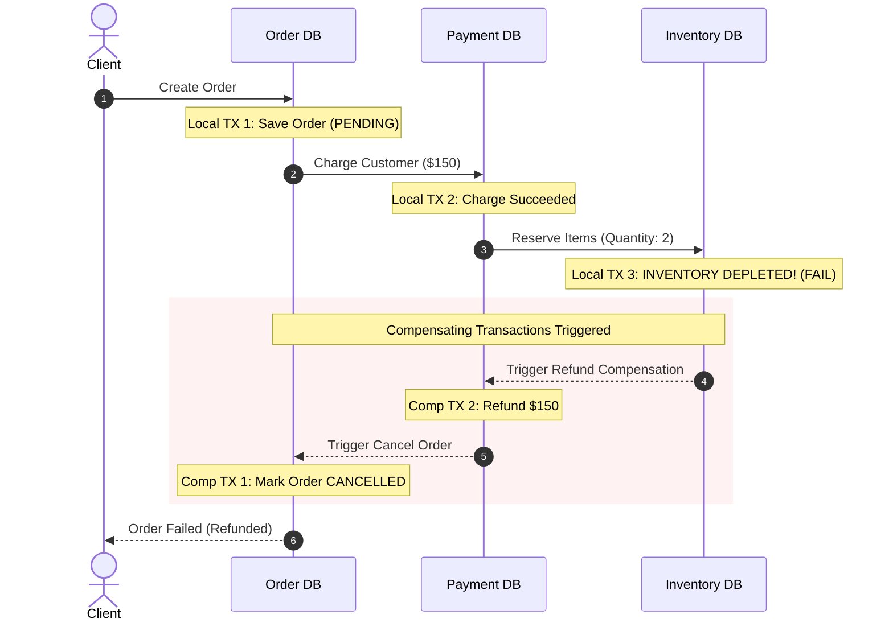

# Spring Boot 4, Distributed Transactions & Architecture Master Interview Guide

> An exhaustive technical reference, deep-dive architectural manual, and senior/staff-level interview guide based on the **E-Commerce Microservice (`java-refresher`)** codebase.

---

## Table of Contents
1. [Codebase Architecture & Spring Boot 4 Configuration Review](#1-codebase-architecture--spring-boot-4-configuration-review)
2. [Deep Dive 1: Spring Transaction Internals & Core Mechanics](#2-deep-dive-1-spring-transaction-internals--core-mechanics)
3. [Deep Dive 2: Multi-Database Coordination & Distributed Transactions (2PC vs. Sagas)](#3-deep-dive-2-multi-database-coordination--distributed-transactions-2pc-vs-sagas)
4. [Deep Dive 3: Managing Large Datasets, High-Throughput Ingestion & Memory Optimization](#4-deep-dive-3-managing-large-datasets-high-throughput-ingestion--memory-optimization)
5. [Deep Dive 4: Concurrency, Locking Strategies & Database Anomalies](#5-deep-dive-4-concurrency-locking-strategies--database-anomalies)
6. [Comprehensive Senior & Staff Interview Q&A Bank (27 Deep Scenarios)](#6-comprehensive-senior--staff-interview-qa-bank)
7. [The Master Study Curriculum & Interview Topic Checklist](#7-the-master-study-curriculum--interview-topic-checklist)

---

## 1. Codebase Architecture & Spring Boot 4 Configuration Review

The [`java-refresher`](file:///Users/luqmansamad/code/feenyx/java-refresher) codebase implements a production-grade **dual-presentation microservice** combining a stateless OAuth2 JWT REST API with a server-rendered Thymeleaf UI, backed by PostgreSQL, Keycloak, and a chunked Spring Batch 6 processing engine.

```
                                  ┌──────────────────────────────┐
                                  │      Client Request (HTTP)   │
                                  └──────────────┬───────────────┘
                                                 │
                                                 ▼
                        ┌───────────────────────────────────────────────────┐
                        │          Spring Security Filter Chain             │
                        └─────────┬───────────────────────────────┬─────────┘
                                  │                               │
         [/api/** - Bearer Token] │                               │ [/** - Session Cookie]
                                  ▼                               ▼
                  ┌───────────────────────────────┐ ┌───────────────────────────────┐
                  │  Order(1): ApiSecurityChain   │ │  Order(2): WebSecurityChain   │
                  │  - Stateless (No Session)     │ │  - Session-based (JSESSIONID) │
                  │  - Keycloak JWT ResourceServer│ │  - Keycloak OIDC SSO Login    │
                  │  - CSRF Disabled              │ │  - CSRF Protection Enabled    │
                  └───────────────┬───────────────┘ └───────────────┬───────────────┘
                                  │                                 │
                                  ▼                                 ▼
                      ┌───────────────────────┐         ┌───────────────────────┐
                      │    @RestController    │         │      @Controller      │
                      │  (JSON Response Body) │         │  (Thymeleaf Template) │
                      └───────────┬───────────┘         └───────────┬───────────┘
                                  │                                 │
                                  └───────────────┬─────────────────┘
                                                  ▼
                                      ┌───────────────────────┐
                                      │     Service Layer     │
                                      │    (@Transactional)   │
                                      └───────────┬───────────┘
                                                  ▼
                                      ┌───────────────────────┐
                                      │  Spring Data JPA Repos│
                                      │  (Hibernate 7 / L1)   │
                                      └───────────┬───────────┘
                                                  ▼
                                      ┌───────────────────────┐
                                      │  PostgreSQL Database  │
                                      └───────────────────────┘
```

### Key Components in this Project

1. **Dual Spring Security Filter Chains ([`SecurityConfig.java`](file:///Users/luqmansamad/code/feenyx/java-refresher/src/main/java/com/practice/java_refresher/security/SecurityConfig.java))**:
   - `@Order(1)` matches `/api/**`: Stateless, CSRF-disabled, OAuth2 JWT bearer token validation using Keycloak claims via [`KeycloakJwtAuthenticationConverter.java`](file:///Users/luqmansamad/code/feenyx/java-refresher/src/main/java/com/practice/java_refresher/security/KeycloakJwtAuthenticationConverter.java).
   - `@Order(2)` matches `/**`: Stateful session management, CSRF tokens, Keycloak OAuth2 / OpenID Connect (OIDC) Single Sign-On (`oauth2Login`) using `ecommerce-client`, mapping realm and resource roles to Spring Security GrantedAuthority instances (`ROLE_USER`, `ROLE_ADMIN`) via [`KeycloakOidcAuthoritiesMapper.java`](file:///Users/luqmansamad/code/feenyx/java-refresher/src/main/java/com/practice/java_refresher/security/KeycloakOidcAuthoritiesMapper.java).

2. **Transactional Order Checkout ([`OrderService.java`](file:///Users/luqmansamad/code/feenyx/java-refresher/src/main/java/com/practice/java_refresher/service/OrderService.java))**:
   - Manages stock verification, atomic inventory decrements, and cascaded order item persistence in a single transaction boundary.

3. **High-Throughput Chunk-Oriented Batch Pipeline ([`BatchJobConfig.java`](file:///Users/luqmansamad/code/feenyx/java-refresher/src/main/java/com/practice/java_refresher/batch/config/BatchJobConfig.java))**:
   - **Step 1 (`importCsvToDbStep`)**: Streams CSV records line-by-line using `FlatFileItemReader` $\rightarrow$ validates via [`ProductCsvProcessor.java`](file:///Users/luqmansamad/code/feenyx/java-refresher/src/main/java/com/practice/java_refresher/batch/processor/ProductCsvProcessor.java) $\rightarrow$ persists in chunks of **500** (`CHUNK_SIZE = 500`) via **`JdbcBatchItemWriter`** (bypassing Hibernate L1 cache for maximal ingestion throughput).
   - **Step 2 (`exportDbToJsonStep`)**: Streams PostgreSQL records via **`JdbcCursorItemReader`** (`dbProductReader()`) $\rightarrow$ transforms via [`ProductJsonProcessor.java`](file:///Users/luqmansamad/code/feenyx/java-refresher/src/main/java/com/practice/java_refresher/batch/processor/ProductJsonProcessor.java) $\rightarrow$ streams JSON directly to disk in chunks of **500** via [`ProductJsonStreamWriter.java`](file:///Users/luqmansamad/code/feenyx/java-refresher/src/main/java/com/practice/java_refresher/batch/writer/ProductJsonStreamWriter.java).
   - **Download Endpoint**: [`GET /api/batch/download`](file:///Users/luqmansamad/code/feenyx/java-refresher/src/main/java/com/practice/java_refresher/controller/BatchController.java) streams the generated JSON file with path-traversal safeguards and direct download buttons in the Thymeleaf batch dashboard.

---

## 2. Deep Dive 1: Spring Transaction Internals & Core Mechanics

### A. How Proxies and AOP Work at Runtime

When Spring boots, `TransactionAttributeSourceAdvisor` detects beans containing `@Transactional` on class or method levels. It wraps the target bean in a **Dynamic Proxy** (CGLIB subclassing by default in Spring Boot, or JDK Dynamic Proxies when interfaces are used).

```
Caller (e.g. Controller / Client)
   │
   ▼
[ Dynamic Proxy (CGLIB Subclass) ]
   │
   ├── 1. Intercepts method invocation via TransactionInterceptor
   ├── 2. Queries PlatformTransactionManager (e.g., JpaTransactionManager)
   ├── 3. Obtains DB Connection from DataSource & binds to ThreadLocal (TransactionSynchronizationManager)
   ├── 4. connection.setAutoCommit(false)
   │
   ▼
[ Actual Target Bean (e.g., OrderService.createOrder) ]
   │
   ├── Executes business logic, repository calls, and SQL queries
   │
   ▼
[ Dynamic Proxy Resumes ]
   │
   ├── 5. Success? connection.commit()
   ├── 6. Exception thrown? Evaluates rollback rules & calls connection.rollback()
   └── 7. Unbinds connection from ThreadLocal & returns to HikariCP pool
```

#### The Self-Invocation Trap

```java
@Service
public class OrderService {

    public void processBatch() {
        // Internal method call:
        this.saveOrder(new Order()); // ❌ TRANSACTION IS COMPLETELY IGNORED!
    }

    @Transactional
    public void saveOrder(Order order) {
        orderRepository.save(order);
    }
}
```

**Why it fails:**
Calls from outside the bean enter through the CGLIB proxy. When `processBatch()` calls `this.saveOrder()`, `this` references the **raw target instance**, bypassing the proxy completely. `TransactionInterceptor` never executes, `connection.setAutoCommit(false)` is never called, and no transaction boundary is established.

**4 Architectural Solutions:**
1. **Separate into Another Bean (Best Practice):** Move `saveOrder` to a dedicated `OrderPersistenceService`.
2. **Self-Injection with `@Lazy`:** Inject `OrderService` into itself:
   ```java
   @Autowired @Lazy private OrderService self;
   public void processBatch() { self.saveOrder(new Order()); }
   ```
3. **`AopContext.currentProxy()`:** Annotate config with `@EnableAspectJAutoProxy(exposeProxy = true)`:
   ```java
   ((OrderService) AopContext.currentProxy()).saveOrder(order);
   ```
4. **AspectJ Bytecode Weaving:** Use compile-time (`ajc`) or load-time weaving (LTW) to weave transaction interception directly into bytecode, removing the need for proxies entirely.

---

### B. Propagation Behaviors & Transaction Trees

Spring supports 7 propagation behaviors defined in `Propagation`:

| Propagation | Existing Transaction Present | No Transaction Present | Common Use-Case |
| :--- | :--- | :--- | :--- |
| **`REQUIRED`** *(Default)* | Joins existing transaction. | Opens a new physical transaction. | Standard business service methods. |
| **`REQUIRES_NEW`** | Suspends existing transaction, opens a new physical connection. | Opens a new physical transaction. | **Audit logging**, payment gateway dispatch, outbox writes that must persist regardless of caller outcome. |
| **`NESTED`** | Creates a JDBC **Savepoint** within current transaction. | Opens a new physical transaction. | Partial rollbacks: attempt secondary payment provider; if it fails, rollback to savepoint without aborting main order. |
| **`MANDATORY`** | Joins existing transaction. | **Throws `IllegalTransactionStateException`**. | Low-level repositories or mutation helpers that must never run outside a transaction. |
| **`SUPPORTS`** | Joins existing transaction. | Executes non-transactionally. | Read methods that can participate in an existing read/write context. |
| **`NOT_SUPPORTED`**| Suspends existing transaction, executes non-transactionally. | Executes non-transactionally. | External network I/O or long-running computations that shouldn't hold DB locks. |
| **`NEVER`** | **Throws `IllegalTransactionStateException`**. | Executes non-transactionally. | Strict safety checks for non-transactional cache updates. |

#### `REQUIRES_NEW` in Action: Auditing & Deadlock Warnings
```java
@Service
public class CheckoutService {
    @Autowired private AuditService auditService;
    @Autowired private OrderRepository orderRepository;

    @Transactional
    public void checkout(OrderRequestDto request) {
        try {
            processPayment(request);
            orderRepository.save(new Order());
        } catch (PaymentException ex) {
            // Must record failure even though checkout aborts:
            auditService.recordAudit("PAYMENT_FAILED", request.getUserId());
            throw ex; // Causes checkout transaction to ROLLBACK
        }
    }
}

@Service
public class AuditService {
    @Transactional(propagation = Propagation.REQUIRES_NEW)
    public void recordAudit(String event, Long userId) {
        // Suspends checkout TX, borrows a 2nd connection from HikariCP,
        // commits audit log, releases 2nd connection, resumes checkout TX.
        auditRepository.save(new AuditLog(event, userId));
    }
}
```
> [!WARNING]
> **HikariCP Pool Exhaustion with `REQUIRES_NEW`:**
> If Thread 1 holds Connection A and requests Connection B for `REQUIRES_NEW`, and all pool connections are occupied by other threads in the same state, a **pool-induced deadlock** occurs. Pool size must be at least:
> $$\text{Pool Size} > \text{Max Threads} \times (\text{Max Nested Connections} - 1)$$

---

### C. Rollback Rules & Checked vs. Unchecked Exceptions

* **Default Behavior:** Spring triggers rollback **only** on **Unchecked Exceptions** (`RuntimeException` and subclasses) and **`Error`** (`OutOfMemoryError`).
* **Checked Exceptions (`Exception`, `IOException`, `SQLException`) DO NOT trigger a rollback by default.** The transaction will commit even if a checked exception escapes!
* **Historical Reason:** Spring followed the EJB standard: checked exceptions represent anticipated business conditions that callers should recover from (e.g., `InsufficientFundsException`), while unchecked exceptions represent unrecoverable technical failures.

```java
// ❌ DANGEROUS: Checked exception escapes, but database changes are COMMITTED!
@Transactional
public void processTransfer() throws InsufficientBalanceException {
    accountRepository.debit(100);
    if (balance < 0) throw new InsufficientBalanceException(); // Will commit debit!
}

// ✅ CORRECT: Explicitly tell Spring to rollback for checked exceptions
@Transactional(rollbackFor = Exception.class)
public void processTransferSafe() throws InsufficientBalanceException { ... }

// Rollback for everything EXCEPT a non-critical notification error:
@Transactional(rollbackFor = Exception.class, noRollbackFor = NonCriticalEmailException.class)
public void placeOrder() { ... }
```

#### Programmatic Rollback Without Throwing Exceptions
```java
if (fraudDetected) {
    TransactionAspectSupport.currentTransactionStatus().setRollbackOnly();
    return OrderResult.rejected("Fraud detected");
}
```

---

### D. Delayed Connection Acquisition: `LazyConnectionDataSourceProxy`

By default, as soon as a thread enters a `@Transactional` method, Spring borrows a physical database connection from HikariCP—even if the method executes 5 seconds of CPU-heavy calculations or REST calls before running its first SQL query!

**The Fix:** Wrap the `DataSource` in `LazyConnectionDataSourceProxy`:
```java
@Bean
@Primary
public DataSource dataSource(DataSource actualHikariDataSource) {
    return new LazyConnectionDataSourceProxy(actualHikariDataSource);
}
```
- A physical connection is **only borrowed from the pool when the first JDBC Statement or PreparedStatement is executed**.
- If a `@Transactional` method exits early due to validation without touching the database, **zero connections are borrowed**, dramatically boosting pool throughput.

---

### E. Open Session in View (OSIV): The Connection Pool Killer

Spring Boot enables `spring.jpa.open-in-view=true` by default.
- It registers an interceptor (`OpenEntityManagerInViewInterceptor`) that binds an `EntityManager` to the HTTP request thread.
- **The Danger:** The database connection is held open across the controller and Thymeleaf/JSON template rendering phase!
- If template rendering is slow or network latency stalls the client response, **database connections remain blocked in the pool**.
- **Production Standard:** Always disable it in `application.properties`:
  ```properties
  spring.jpa.open-in-view=false
  ```
- Solve lazy loading issues in the service/repository layer using **`JOIN FETCH`** or **`@EntityGraph`** ([`OrderRepository.java`](file:///Users/luqmansamad/code/feenyx/java-refresher/src/main/java/com/practice/java_refresher/repository/OrderRepository.java#L16)).

---

## 3. Deep Dive 2: Multi-Database Coordination & Distributed Transactions (2PC vs. Sagas)

### A. The "Writing to Two Databases" Dilemma

A common senior interview scenario is:
> *"Our service needs to insert an Order into `OrderDB` (PostgreSQL) and update user loyalty points in `UserDB` (MySQL / Oracle). How do you handle transaction management across both?"*

```
                     ┌────────────────────────────────┐
                     │     Spring Application         │
                     └───────┬────────────────┬───────┘
                             │                │
                Connection 1 │                │ Connection 2
                             ▼                ▼
                     ┌───────────────┐ ┌───────────────┐
                     │    OrderDB    │ │    UserDB     │
                     │  (PostgreSQL) │ │    (MySQL)    │
                     └───────────────┘ └───────────────┘
```

#### Approach 1: Why `ChainedTransactionManager` (Best-Effort 1PC) is Dangerous & Deprecated
Spring historically offered `ChainedTransactionManager`:
```java
// DEPRECATED IN SPRING 5.3 / BOOT 3
PlatformTransactionManager tm = new ChainedTransactionManager(orderTxManager, userTxManager);
```
**Why it fails:**
It commits sequentially:
1. `orderTxManager.commit()` $\rightarrow$ **Succeeds!**
2. `userTxManager.commit()` $\rightarrow$ **Fails (network crash / timeout)!**
3. `orderTxManager` has already committed. It cannot be rolled back. Result: **Data inconsistency**.

---

#### Approach 2: Two-Phase Commit (2PC) / XA Protocol

Using JTA (Java Transaction API) with an XA-compliant coordinator (e.g., Atomikos, Bitronix, Narayana):

```
       Coordinator (Atomikos / JTA)
           │                    │
  Phase 1: │ PREPARE?           │ PREPARE?
           ▼                    ▼
     [ OrderDB (XA) ]     [ UserDB (XA) ]
     (Locks row; votes YES) (Locks row; votes YES)
           │                    │
  Phase 2: │ COMMIT!            │ COMMIT!
           ▼                    ▼
     [ Both Databases Commit Atomically ]
```

#### Why 2PC / XA Fails in Modern Cloud & Microservices:
1. **Blocking & Latency:** DB locks are held across network hops from Phase 1 prepare until Phase 2 commit completes. Database connection pools rapidly exhaust.
2. **Single Point of Failure (Coordinator):** If the coordinator crashes between Phase 1 and Phase 2, participants remain blocked in "in-doubt" states holding row locks indefinitely.
3. **Incompatible with Modern Infrastructure:** Distributed caches (Redis), message brokers (Kafka/RabbitMQ), NoSQL stores (DynamoDB/Cassandra), and 3rd-party APIs (Stripe, Twilio) **do not support XA protocols**.

---

#### Approach 3: The Production Solution — The Saga Pattern (Eventual Consistency)

Instead of distributed physical transactions, execute a sequence of **local ACID transactions** coordinated via asynchronous messaging. If any step fails, trigger **compensating transactions** to undo previous forward operations.



#### Orchestration vs. Choreography Sagas

| Dimension | Orchestration-Based Saga | Choreography-Based Saga |
| :--- | :--- | :--- |
| **Control** | A centralized **Saga Orchestrator** (State Machine) sends commands to services. | Decentralized: Services react to domain events published to message brokers (Kafka). |
| **Coupling** | Services depend on orchestrator commands; orchestrator knows full workflow. | Services are loosely coupled; only need to know events they produce and consume. |
| **Observability** | **High:** Workflow state, current step, and error states are centralized. | **Low:** Workflow is distributed across event streams; requires distributed tracing (OpenTelemetry). |
| **Failure Handling** | Orchestrator explicitly invokes compensating endpoints in reverse order. | Every participating service must listen for failure events and trigger its own compensation. |
| **Complexity** | Central orchestrator code can grow into a "God object". | High risk of circular event dependencies, event storms, and untraced edge-case failures. |
| **Best For** | Complex flows with 4+ steps (e.g. Order $\rightarrow$ Payment $\rightarrow$ Inventory $\rightarrow$ Shipping). | Simple 2-3 step flows (e.g. User Registered $\rightarrow$ Send Welcome Email). |

---

### B. The Transactional Outbox Pattern & CDC (Debezium)

A critical dual-write failure:
```java
@Transactional
public void createOrder(Order order) {
    orderRepository.save(order);       // 1. DB Commit
    kafkaTemplate.send("orders", order); // 2. Network call to Kafka
}
```
**Anomalies:**
- If Kafka fails or network drops, the DB transaction rolls back, but what if DB commits and Kafka fails right after?
- If Kafka call succeeds but DB commit fails on constraint violation, the message was sent for an order that never existed!

#### Solution: Transactional Outbox Pattern
```
┌────────────────────────────────────────────────────────┐
│               PostgreSQL Database                      │
│                                                        │
│  ┌──────────────────────┐    ┌──────────────────────┐  │
│  │     orders table     │    │     outbox table     │  │
│  │ (id, status, total)  │    │(id, topic, payload)  │  │
│  └──────────────────────┘    └──────────────────────┘  │
│              ▲                          ▲              │
│              │                          │              │
│              └────────────┬─────────────┘              │
│                           │                            │
│           Single Local ACID Transaction                │
└───────────────────────────┼────────────────────────────┘
                            │
               PostgreSQL Write-Ahead Log (WAL)
                            │
                            ▼
               ┌─────────────────────────┐
               │    Debezium CDC         │
               └────────────┬────────────┘
                            │
                            ▼
               ┌─────────────────────────┐
               │       Kafka Topic       │
               └─────────────────────────┘
```

1. Insert business entity into `orders` AND insert an event into an `outbox` table in the **same local ACID transaction**.
2. **Debezium CDC** (Change Data Capture) tails the database transaction log (PostgreSQL WAL) and streams the event into Kafka with zero application-level dual-write risk.
3. Guaranteed **At-Least-Once** delivery. Downstream consumers use an **Idempotency Key** to deduplicate.

---

### C. Designing Semantic Compensating Transactions & Idempotency

#### Compensating Transactions are NOT Physical Rollbacks
- A physical rollback resets database blocks using undo logs.
- A **compensating transaction** is a new **forward-facing business action** that neutralizes the business impact of a previous action (e.g., executing a credit operation to balance an earlier debit).
- **Pivot Transaction:** The point of no return. Once the pivot transaction commits, the Saga must complete forward (cannot be cancelled, only fixed via forward recovery or manual intervention).

#### Idempotency Key Design
Network retries are inevitable. Every consumer must be idempotent:
```sql
CREATE TABLE processed_messages (
    message_id VARCHAR(128) PRIMARY KEY,
    consumer_group VARCHAR(64) NOT NULL,
    processed_at TIMESTAMP DEFAULT CURRENT_TIMESTAMP
);
```
```java
@Transactional
public void handlePaymentRefund(String messageId, RefundCommand command) {
    // 1. Atomic insert check
    int inserted = jdbcTemplate.update(
        "INSERT INTO processed_messages (message_id, consumer_group) VALUES (?, ?) ON CONFLICT DO NOTHING",
        messageId, "payment-service-group"
    );
    if (inserted == 0) {
        log.info("Duplicate message {} ignored", messageId);
        return; // Already processed!
    }

    // 2. Execute refund logic
    paymentGateway.refund(command.getChargeId(), command.getAmount());
}
```

---

## 4. Deep Dive 3: Managing Large Datasets, High-Throughput Ingestion & Memory Optimization

### A. Preventing OutOfMemoryError in Bulk Processing

#### The Hibernate 1st-Level Cache Trap
When querying thousands of rows via `productRepository.findAll()`, Hibernate keeps a reference to **every managed entity** in the `EntityManager` persistence context (1st-level cache) for dirty checking.
- Loading 1,000,000 entities puts 1,000,000 Java objects in heap, causing catastrophic GC pauses and `OutOfMemoryError: Java heap space`.

#### Solutions:
1. **Periodic `flush()` and `clear()`:**
   ```java
   @Transactional
   public void batchUpdate(List<Product> products) {
       for (int i = 0; i < products.size(); i++) {
           entityManager.merge(products.get(i));
           if (i > 0 && i % 50 == 0) {
               entityManager.flush(); // Sends queued SQL to DB
               entityManager.clear(); // Evicts all entities from L1 cache!
           }
       }
   }
   ```

2. **Hibernate `StatelessSession` (Maximum Throughput):**
   ```java
   SessionFactory sessionFactory = entityManagerFactory.unwrap(SessionFactory.class);
   try (StatelessSession session = sessionFactory.openStatelessSession()) {
       Transaction tx = session.beginTransaction();
       // Bypasses 1st-level cache entirely!
       // Zero dirty-checking snapshots, zero entity state tracking.
       session.insert(newProduct);
       tx.commit();
   }
   ```

3. **Spring Batch Chunking ([`BatchJobConfig.java`](file:///Users/luqmansamad/code/feenyx/java-refresher/src/main/java/com/practice/java_refresher/batch/config/BatchJobConfig.java)):**
   - Keeps memory usage strictly bounded to $O(\text{chunk\_size})$ (where `CHUNK_SIZE = 500`).
   - Reads 500 records $\rightarrow$ Processes 500 records $\rightarrow$ Writes 500 records via `JdbcBatchItemWriter` $\rightarrow$ Commits transaction.
   - Using native JDBC batching (`PreparedStatement.executeBatch()`) completely bypasses the Hibernate 1st-level cache and entity dirty checking, preventing heap bloat entirely.

---

### B. High-Performance JDBC Batching Configuration

To enable true multi-row JDBC batching (`INSERT INTO table VALUES (...), (...), (...)`), configure Hibernate and JDBC driver properties:

```properties
# Enable Hibernate Batching
spring.jpa.properties.hibernate.jdbc.batch_size=50
spring.jpa.properties.hibernate.order_inserts=true
spring.jpa.properties.hibernate.order_updates=true
spring.jpa.properties.hibernate.jdbc.batch_versioned_data=true

# CRITICAL for PostgreSQL (re-writes separate INSERTs into a single multi-row statement):
spring.datasource.url=jdbc:postgresql://localhost:5432/ecommerce?reWriteBatchedInserts=true

# CRITICAL for MySQL:
# spring.datasource.url=jdbc:mysql://localhost:3306/ecommerce?rewriteBatchedStatements=true
```

> [!IMPORTANT]
> **GenerationType.IDENTITY Disables Batching:**
> If an entity uses `@GeneratedValue(strategy = GenerationType.IDENTITY)`, Hibernate **must immediately fire an SQL INSERT** for each entity to obtain its database-generated primary key. Batching is completely disabled!
> - **Solution:** Use `@GeneratedValue(strategy = GenerationType.SEQUENCE)` with an allocation size matching the batch size (`allocationSize = 50`), or client-generated UUIDs (`UUIDv7` or `TSID`).

---

### C. Keyset (Seek) Pagination vs. Offset Pagination

| Metric | Offset Pagination (`OFFSET 1000000 LIMIT 50`) | Keyset Pagination (`WHERE id > :lastId LIMIT 50`) |
| :--- | :--- | :--- |
| **SQL** | `SELECT * FROM products ORDER BY id LIMIT 50 OFFSET 1000000;` | `SELECT * FROM products WHERE id > 1000000 ORDER BY id ASC LIMIT 50;` |
| **Complexity** | $O(N)$ — DB must scan 1,000,050 rows and discard the first 1,000,000. | $O(\log N)$ — B-Tree index seek directly locates row 1,000,000. |
| **Execution Time** | Increases linearly with page depth (5000ms+ at deep offsets). | **Constant time ($<2\text{ms}$)** regardless of whether fetching page 1 or page 10,000. |
| **Data Drifts** | New inserts shift offsets, causing duplicate or skipped rows. | **Stable:** Unaffected by concurrent inserts before the cursor. |

---

### D. Spring Batch Transaction Management & Chunk-Oriented Processing

In high-throughput ETL pipelines (such as [`BatchJobConfig.java`](file:///Users/luqmansamad/code/feenyx/java-refresher/src/main/java/com/practice/java_refresher/batch/config/BatchJobConfig.java)), transactions are demarcated at the **chunk boundary** rather than per record or per job.

```
                      CHUNK BOUNDARY (e.g. CHUNK_SIZE = 500)
┌────────────────────────────────────────────────────────────────────────────┐
│ 1. Transaction Begun by PlatformTransactionManager                         │
│                                                                            │
│    ┌──────────────────┐                                                    │
│    │ ItemReader       │ ──> Read item 1 .. 500 sequentially                │
│    └────────┬─────────┘                                                    │
│             │                                                              │
│             ▼                                                              │
│    ┌──────────────────┐                                                    │
│    │ ItemProcessor    │ ──> Transform/Validate item 1 .. 500               │
│    └────────┬─────────┘                                                    │
│             │                                                              │
│             ▼                                                              │
│    ┌──────────────────┐                                                    │
│    │ ItemWriter       │ ──> Batch Write List of 500 items to DB in one go  │
│    └──────────────────┘                                                    │
│                                                                            │
│ 2. PlatformTransactionManager.commit()                                     │
│    ├── Commits all 500 DB records atomically                               │
│    └── Commits BATCH_STEP_EXECUTION metadata & ExecutionContext offsets     │
└────────────────────────────────────────────────────────────────────────────┘
```

#### 1. The Role of `PlatformTransactionManager` & `StepBuilder`
- **Configuration vs. Execution**: `StepBuilder` is merely a fluent configuration DSL. It does **not** execute transactions itself. Instead, it builds a `TaskletStep` backed by a `ChunkOrientedTasklet` (or `FaultTolerantChunkProcessor`) that wraps chunk processing in Spring's programmatic `TransactionTemplate`.
- **Mandatory in Spring Batch 5+**: Legacy `StepBuilderFactory` (which implicitly inherited transaction managers) was deprecated and removed. In modern Spring Batch, developers must explicitly pass both `JobRepository` and `PlatformTransactionManager` to the `StepBuilder`:
  ```java
  new StepBuilder("importCsvToDbStep", jobRepository)
      .<ProductCsvDto, Product>chunk(CHUNK_SIZE)
      .transactionManager(transactionManager) // REQUIRED in Spring Batch 5+
      .reader(csvProductReader)
      .processor(productCsvProcessor)
      .writer(jdbcProductWriter())
      ...
  ```
- **Source of the Bean**: Spring Boot auto-configures `PlatformTransactionManager` (`JpaTransactionManager` or `DataSourceTransactionManager` depending on classpath dependencies), which coordinates connections, physical commits, and rollbacks on the underlying `DataSource`.

#### 2. Chunk-Level Transaction Lifecycle
For a job with `CHUNK_SIZE = 500`:
1. **Transaction Start**: The step asks `PlatformTransactionManager` to start a new transaction (`getTransaction()`).
2. **Read Loop**: The `ItemReader` fetches items one by one until 500 items are gathered or `read()` returns `null` (EOF).
3. **Process Loop**: Each item is passed to the `ItemProcessor`. If an item is filtered out (processor returns `null`), it is excluded from the chunk.
4. **Batch Write**: When 500 processed items accumulate, they are passed as a `Chunk<O>` to `ItemWriter.write(chunk)`. In [`jdbcProductWriter()`](file:///Users/luqmansamad/code/feenyx/java-refresher/src/main/java/com/practice/java_refresher/batch/config/BatchJobConfig.java#L81-L90), JDBC batch execution fires a single multi-row prepared statement.
5. **Commit**: If no exceptions occur, `PlatformTransactionManager.commit()` commits the 500 inserted rows **and** saves the step execution state (read count, commit count, stream positions) into Spring Batch's metadata tables (`BATCH_STEP_EXECUTION`, `BATCH_STEP_EXECUTION_CONTEXT`).

#### 3. What Happens When a Chunk Fails? (Standard vs. Fault-Tolerant)

A common point of confusion is what happens to the entire job when a single chunk (or batch) encounters an error:

##### A. Are Previously Committed Chunks Rolled Back?
**No. In Spring Batch, previously committed chunks remain permanently committed.**
* Each chunk boundary represents an **independent, physical database transaction**.
* If a job has 20 chunks of 500 items (10,000 items total) and **Chunk 5 fails**:
  * **Chunks 1 through 4 (items 1–2,000)** were already committed in their own separate transactions. They are **safe and preserved** in the database.
  * Only **Chunk 5 (items 2,001–2,500)** is rolled back.
  * Future chunks (6 through 20) are halted.

##### B. Scenario 1: Standard Step (No Fault Tolerance)
*(e.g., [`exportDbToJsonStep`](file:///Users/luqmansamad/code/feenyx/java-refresher/src/main/java/com/practice/java_refresher/batch/config/BatchJobConfig.java#L138-L147))*

1. **Immediate Chunk Rollback**: The active transaction for the failing 500-item chunk is rolled back immediately via `PlatformTransactionManager.rollback()`.
2. **Step & Job Transition to `FAILED`**:
   * Execution stops immediately.
   * Spring Batch records the status as `FAILED` in the metadata table `BATCH_STEP_EXECUTION`, along with the exception stack trace in `EXIT_MESSAGE`.
3. **Execution Context Preservation**:
   * Spring Batch preserves the progress of the last successfully committed chunk (`commitCount = 4`, `readCount = 2000`) in `BATCH_STEP_EXECUTION_CONTEXT`.
4. **Behavior on Job Restart**:
   * When re-launched with identical job parameters, Spring Batch **does not start from scratch**.
   * It inspects `BATCH_STEP_EXECUTION_CONTEXT`, skips the 2,000 items that already committed, and **resumes execution directly at Chunk 5 (item 2,001)**!

##### C. Scenario 2: Fault-Tolerant Step (With `skip`)
*(e.g., [`importCsvToDbStep`](file:///Users/luqmansamad/code/feenyx/java-refresher/src/main/java/com/practice/java_refresher/batch/config/BatchJobConfig.java#L93-L105) configured with `.faultTolerant().skip(Exception.class).skipLimit(20)`)*

1. **Chunk Rollback**: The failing chunk's transaction rolls back completely.
2. **Item-by-Item Scan Mode**:
   * `FaultTolerantChunkProcessor` switches to **scan mode** and retries the failed chunk **one item at a time**, executing each in an isolated single-item transaction.
3. **Isolating & Discarding Bad Data**:
   * Valid items (e.g. items 1–419) execute and commit individually.
   * When the bad record (e.g. item 420 with malformed CSV data or a constraint violation) throws an exception:
     * Spring Batch checks if the exception matches the configured `.skip()` class and if `skipCount < skipLimit`.
     * It increments `skipCount` in `BATCH_STEP_EXECUTION`, swallows the error, and discards item 420.
4. **Resuming Normal Chunking**:
   * Items 421–500 process and commit.
   * Normal chunk-sized processing resumes for Chunk 6 onward. The job completes with status `COMPLETED` (with a recorded skip count).
5. **If Skips Exceed `skipLimit`**:
   * If a 21st record fails, the exception is propagated, scan mode aborts, and the step terminates as `FAILED` (falling back to Scenario 1).

> [!WARNING]
> **Transaction Multiplication During Rollback Scans:**
> If a chunk of 500 items encounters an error during writer execution with skip enabled, Spring Batch rolls back and executes 500 individual transactions to isolate the bad item. In high-concurrency environments, this can cause temporary connection starvation and transaction log spikes!

##### D. Chunk Failure Comparison Matrix

| Lifecycle Aspect | Standard Step (No Fault Tolerance) | Fault-Tolerant Step (`skipLimit = 20`) |
| :--- | :--- | :--- |
| **Current Chunk** | Rolled back completely. | Rolled back, scanned item-by-item, bad items discarded, valid items committed. |
| **Past Chunks** | Untouched (already committed). | Untouched (already committed). |
| **Future Chunks** | Halted (never executed). | Processed normally if skips stay $\le 20$. |
| **Final Step Status** | `FAILED` | `COMPLETED` (if skips $\le 20$) or `FAILED` (if skips $> 20$). |
| **On Job Restart** | Resumes from failed chunk via `ExecutionContext`. | N/A if completed; resumes from failure point if skip limit exceeded. |

#### 4. The Non-Transactional Resource Pitfall (File & Stream Writers)
Notice `exportDbToJsonStep` in [`BatchJobConfig.java`](file:///Users/luqmansamad/code/feenyx/java-refresher/src/main/java/com/practice/java_refresher/batch/config/BatchJobConfig.java#L138-L147):
- Even though the writer writes to a file ([`ProductJsonStreamWriter.java`](file:///Users/luqmansamad/code/feenyx/java-refresher/src/main/java/com/practice/java_refresher/batch/writer/ProductJsonStreamWriter.java)), `transactionManager` is still strictly required to manage the database cursor stream (`JdbcCursorItemReader`) and commit Spring Batch metadata.
- **The Caveat**: Files, sockets, and object stores (S3) are **non-transactional resources**. If an error occurs on item 490:
  - The database cursor transaction and batch metadata transaction roll back.
  - However, bytes already written to the file via `writer.write()` **cannot be rolled back by the database transaction manager**.
- **Production Solutions for Non-Transactional Writers**:
  1. **Write to Temp File + Atomic Rename**: Write output to a `.tmp` file and only rename it to the final target file in a `StepExecutionListener.afterStep()` when `stepExecution.getStatus() == BatchStatus.COMPLETED`.
  2. **Track Byte Offsets via `ItemStream`**: Implement `ItemStream.update(ExecutionContext)` to record the exact byte offset at each chunk commit. On job restart, seek (`RandomAccessFile.seek()`) or truncate the file back to the last committed offset before resuming.

##### Production File Retrieval & Streaming Architecture (`GET /api/batch/download`)
Once a batch job's stream writer ([`ProductJsonStreamWriter.java`](file:///Users/luqmansamad/code/feenyx/java-refresher/src/main/java/com/practice/java_refresher/batch/writer/ProductJsonStreamWriter.java)) finishes writing records to disk, downstream clients and web frontends require a reliable, high-performance download endpoint.

In [`BatchController.java`](file:///Users/luqmansamad/code/feenyx/java-refresher/src/main/java/com/practice/java_refresher/controller/BatchController.java):
```java
@GetMapping("/download")
@Operation(summary = "Download ProductJsonStreamWriter JSON Output")
public ResponseEntity<Resource> downloadExportedJson(
        @RequestParam(defaultValue = "data/exported_products.json") String filePath,
        @RequestParam(required = false) Long jobExecutionId)
```

**Key Architectural & Security Patterns Implemented**:
1. **Zero-Copy / Heap-Bounded Streaming (`ResponseEntity<Resource>`)**:
   - Returning `byte[]` requires reading the full file into JVM heap space. For a 500 MB exported JSON file, concurrent downloads quickly cause `OutOfMemoryError`.
   - Returning `FileSystemResource` allows Spring MVC and Tomcat to delegate directly to the operating system's NIO `FileChannel.transferTo()` (zero-copy kernel buffer transfer), transferring bytes straight from the page cache to the network socket with $O(1)$ JVM heap footprint.
2. **Defending Against Path Traversal (CWE-22)**:
   - Query parameters like `?filePath=...` are untrusted user input that could access sensitive host files (`/etc/passwd` or `build.gradle`).
   - Mitigated by resolving normalized absolute paths and strictly verifying directory containment:
     ```java
     Path basePath = Paths.get("data").toAbsolutePath().normalize();
     Path resolvedPath = Paths.get(targetPath).toAbsolutePath().normalize();
     if (!resolvedPath.startsWith(basePath)) {
         return ResponseEntity.badRequest().build(); // 400 Bad Request
     }
     ```
3. **Correlating Metadata via `JobRepository`**:
   - Accepts `jobExecutionId` to dynamically look up the exact file produced by that run from `JobParameters['outputJsonPath']` stored in `JobRepository`, ensuring clients retrieve verified batch outputs.
4. **RFC-Compliant Content Disposition**:
   - Sets `HttpHeaders.CONTENT_DISPOSITION = "attachment; filename=\"...\""`, instructing user agents to save to disk rather than render JSON in the browser window, with `Content-Length` for download progress tracking.

#### 5. Database ItemWriters for Business Data

When persisting chunk results to a database, Spring Batch provides three primary `ItemWriter` implementations, each with distinct architectural and performance trade-offs:

```
                          ItemWriter<T>
                               │
       ┌───────────────────────┼───────────────────────┐
       ▼                       ▼                       ▼
JdbcBatchItemWriter      JpaItemWriter        RepositoryItemWriter
(Direct SQL / Native     (Hibernate /         (Spring Data JPA
 Prepared Statements)     EntityManager)       saveAll / Repository)
  ⭐ Best Performance       Rich Entity Graphs   High Abstraction
```

##### A. `JdbcBatchItemWriter` (High-Throughput / Direct SQL)
* **Package**: `org.springframework.batch.infrastructure.item.database.JdbcBatchItemWriter<T>`
* **Mechanism**: Executes parameterized SQL via JDBC `PreparedStatement.addBatch()` and `executeBatch()`.
* **Why it is fastest**: Completely bypasses the Hibernate `EntityManager`, dirty checking, and 1st-level cache. Memory remains flat $O(\text{chunk\_size})$, and network roundtrips are minimized (especially when combined with PostgreSQL `reWriteBatchedInserts=true`).
* **Code Example** (from [`BatchJobConfig.java`](file:///Users/luqmansamad/code/feenyx/java-refresher/src/main/java/com/practice/java_refresher/batch/config/BatchJobConfig.java#L81-L90)):
  ```java
  @Bean
  public JdbcBatchItemWriter<Product> jdbcProductWriter() {
      return new JdbcBatchItemWriterBuilder<Product>()
              .dataSource(dataSource)
              .sql("""
                   INSERT INTO products (name, description, price, stock_quantity, category, created_at, updated_at)
                   VALUES (:name, :description, :price, :stockQuantity, :category, NOW(), NOW())
                   """)
              .beanMapped() // Maps Product getters to named parameters
              .build();
  }
  ```

##### B. `JpaItemWriter` (Entity Graphs & Cascades)
* **Package**: `org.springframework.batch.infrastructure.item.database.JpaItemWriter<T>`
* **Mechanism**: Takes an `EntityManagerFactory` and calls `entityManager.merge(item)` for each item in the chunk. Hibernate automatically flushes SQL queries upon transaction commit.
* **When to choose**: When incoming entities have nested child collections (`@OneToMany` with `CascadeType.ALL`), complex auditing listeners (`@PrePersist`), or polymorphic inheritance.
* **Trade-off**: Higher CPU and memory overhead. Hibernate maintains snapshot copies of every entity for dirty checking in the persistence context, which slows down bulk writes compared to native JDBC.

##### C. `RepositoryItemWriter` (Spring Data Repositories)
* **Package**: `org.springframework.batch.infrastructure.item.data.RepositoryItemWriter<T>`
* **Mechanism**: Adapts an existing Spring Data repository (e.g., `ProductRepository.save(item)` or `saveAll`).
* **When to choose**: Simple, low-to-medium volume pipelines where developers want to reuse domain logic already encapsulated in Spring Data repositories.

##### Comparison Summary

| Metric | `JdbcBatchItemWriter` | `JpaItemWriter` | `RepositoryItemWriter` |
| :--- | :--- | :--- | :--- |
| **Throughput** | ⚡⚡⚡ **Maximum** (10x+ faster) | ⚡ **Moderate** | ⚡ **Moderate** |
| **Heap Memory Overhead** | **Near-zero** (scalar streams) | **High** (L1 cache entity graph) | **High** (Spring Data wrapping) |
| **Cascade Support** | Manual SQL required | **Automatic** (`CascadeType.ALL`) | Dependent on Repository methods |
| **Recommended Use Case** | Bulk imports, high-speed ETL | Complex domain aggregates | Lightweight utility batch steps |

---

#### 6. Spring Batch Internal Metadata Persistence (JobRepository & Schema)

In addition to business tables, Spring Batch requires a relational database schema to persist job execution history, step metrics, and restart tokens.

##### A. Core Framework Classes
1. **`JobRepository` (`SimpleJobRepository`)**:
   - The central transactional data access layer for all Spring Batch metadata.
   - Handled automatically by Spring Boot's `BatchAutoConfiguration` using the primary `DataSource` and `PlatformTransactionManager`.
2. **`DefaultBatchConfiguration`**:
   - The base configuration class in Spring Batch 5+ for customizing the `JobRepository`, transaction isolation level (`ISOLATION_DEFAULT` / `ISOLATION_SERIALIZABLE`), and table prefix.

##### B. The 6 Core Metadata Tables
Spring Batch maintains strict relational integrity across 6 internal tables:

```
┌─────────────────────────────────┐
│       BATCH_JOB_INSTANCE        │ (Represents unique Job Name + JobParameters)
└────────────────┬────────────────┘
                 │ 1:N
┌────────────────▼────────────────┐
│      BATCH_JOB_EXECUTION        │ (Execution attempt: START_TIME, END_TIME, STATUS, EXIT_CODE)
├─────────────────────────────────┤
│  BATCH_JOB_EXECUTION_PARAMS     │ (String, Long, Date key-value parameters passed at launch)
│  BATCH_JOB_EXECUTION_CONTEXT    │ (Serialized JobExecutionContext for job-level restart state)
└────────────────┬────────────────┘
                 │ 1:N
┌────────────────▼────────────────┐
│      BATCH_STEP_EXECUTION       │ (Step execution: READ_COUNT, WRITE_COUNT, COMMIT_COUNT, ROLLBACK_COUNT)
├─────────────────────────────────┤
│  BATCH_STEP_EXECUTION_CONTEXT   │ (Serialized step state: item offsets, reader positions)
└─────────────────────────────────┘
```

##### C. Schema Initialization in Spring Boot
In `application.properties` / `application.yml`:
```properties
# Options: always | embedded (H2/HSQL) | never (production with Flyway/Liquibase)
spring.batch.jdbc.initialize-schema=always

# Custom table prefix if shared with existing legacy schemas (default: BATCH_)
spring.batch.jdbc.table-prefix=BATCH_
```
* **Production Best Practice**: In enterprise deployments, set `initialize-schema=never` and manage DDL scripts through **Flyway** or **Liquibase** using the official dialect scripts located at `org/springframework/batch/core/schema-postgresql.sql`.

---

#### 7. Threading Model & Execution Mechanics: Synchronous vs. Asynchronous Batch Jobs

A critical architectural question is: **Does Spring Batch run as an asynchronous future, or on the same caller thread?**

##### A. Default Behavior: Synchronous on the Calling Thread
By default in Spring Batch and Spring Boot auto-configuration, `JobLauncher` (and `JobOperator`) is wired with a `SyncTaskExecutor`:
* **The REST Controller Trap**: When a controller triggers a job via `jobOperator.start(...)` (as in [`BatchController.java`](file:///Users/luqmansamad/code/feenyx/java-refresher/src/main/java/com/practice/java_refresher/controller/BatchController.java#L60)):
  * The incoming Tomcat HTTP thread (`http-nio-8080-exec-*`) **blocks and executes the entire batch job synchronously**.
  * The thread reads items, runs processors, executes chunk transactions, and writes to the database for all 10,000+ items before generating an HTTP response.
  * **Production Risk**: If the batch job takes 3 minutes, the client HTTP connection remains open for 3 minutes, triggering gateway timeouts (HTTP 504), proxy disconnects, and thread pool exhaustion in Tomcat.
* **The Startup Trap**: If a job is executed at boot time via `JobLauncherApplicationRunner`, it blocks the `main()` thread, preventing the application from opening health check endpoints until the job finishes.

##### B. Decoupling with Asynchronous Job Launching
To make job triggering non-blocking and return immediately with an HTTP `202 Accepted`, configure an asynchronous `TaskExecutor` on the `JobLauncher`:

```java
@Bean
public JobLauncher asyncJobLauncher(JobRepository jobRepository) throws Exception {
    TaskExecutorJobLauncher launcher = new TaskExecutorJobLauncher();
    launcher.setJobRepository(jobRepository);
    // Asynchronous background execution (or Java 21+ Virtual Threads!)
    launcher.setTaskExecutor(new SimpleAsyncTaskExecutor());
    launcher.afterPropertiesSet();
    return launcher;
}
```

**Non-Blocking REST Workflow**:
1. Client issues `POST /api/batch/import`.
2. The controller calls `jobOperator.start(...)`, which delegates to the async launcher.
3. The method returns **immediately** ($<5\text{ms}$) with a `JobExecution` whose status is `STARTING` or `STARTED`.
4. The client receives an immediate response containing `jobExecutionId`:
   ```json
   {
     "jobExecutionId": 105,
     "status": "STARTED"
   }
   ```
5. The client subsequently polls `GET /api/batch/status/105` (implemented in [`BatchController.java#L105`](file:///Users/luqmansamad/code/feenyx/java-refresher/src/main/java/com/practice/java_refresher/controller/BatchController.java#L105)) to inspect progress, or registers a webhook via `JobExecutionListener.afterJob()`.

##### C. Threading Inside the Job: Step & Chunk Concurrency
Even when the job runs on a background thread, what thread model governs internal chunk execution?

```
                       Job Thread (Async / Sync)
                               │
       ┌───────────────────────┼───────────────────────┐
       ▼                       ▼                       ▼
  Sequential              Multi-Threaded           Partitioned
(Default: 1 chunk        (.taskExecutor()         (Master/Worker
 at a time on 1 thread)    parallel chunks)         across nodes/threads)
```

1. **Sequential Execution (Default)**:
   - Chunks run one after another on the single worker thread. Fully deterministic and preserves step restart offsets in `ExecutionContext`.
2. **Multi-Threaded Steps (`.taskExecutor(taskExecutor)`)**:
   - Chunks are distributed concurrently across a thread pool:
     ```java
     return new StepBuilder("parallelStep", jobRepository)
             .<ProductCsvDto, Product>chunk(500)
             .transactionManager(transactionManager)
             .reader(pagingProductReader)
             .writer(jdbcProductWriter())
             .taskExecutor(new ThreadPoolTaskExecutor()) // Concurrent chunk processing!
             .build();
     ```
   > [!CAUTION]
   > **The Thread-Safety Trap with Readers:**
   > - Stateful readers like `FlatFileItemReader` and `JdbcCursorItemReader` maintain internal row cursors and are **NOT thread-safe**. If multiple threads invoke `read()` concurrently, data will be skipped, duplicated, or corrupted.
   > - **Solutions**: Use inherently thread-safe readers such as `JdbcPagingItemReader`, or wrap stateful readers with `SynchronizedItemStreamReader`.
   > - **Restartability Loss**: Because chunks finish out of order, Spring Batch cannot maintain a sequential pointer in `ExecutionContext`. Multi-threaded steps cannot guarantee safe mid-step restartability.

##### D. Threading Matrix Summary

| Layer | Default Behavior | How to Make Concurrent | Production Considerations |
| :--- | :--- | :--- | :--- |
| **Job Launch** | Synchronous on caller thread (`SyncTaskExecutor`) | Inject `TaskExecutor` into `TaskExecutorJobLauncher` | Mandatory for REST API triggers; prevents 504 timeouts. |
| **Step Flow** | Sequential (`step1 -> step2`) | Use `.split(taskExecutor)` or Parallel Flow | Best for independent data steps (e.g. import users + import products). |
| **Chunk Processing** | Single thread per step | Add `.taskExecutor()` to `StepBuilder` | Requires thread-safe reader (`JdbcPagingItemReader`); sacrifices restartability. |

---

## 5. Deep Dive 4: Concurrency, Locking Strategies & Database Anomalies

### A. Database Anomalies & Isolation Levels

* **Dirty Read:** Transaction A reads uncommitted writes from Transaction B. If B aborts, A holds invalid data.
* **Non-Repeatable Read:** Transaction A reads row $X$. Transaction B updates/deletes row $X$ and commits. Transaction A re-reads row $X$ and sees mutated values.
* **Phantom Read:** Transaction A queries rows matching a filter (`WHERE price > 100`). Transaction B inserts new rows matching that filter and commits. Transaction A re-runs the query and sees new "phantom" rows.

| Isolation Level | Dirty Read | Non-Repeatable Read | Phantom Read | Engine Mechanism (PostgreSQL / MVCC) |
| :--- | :---: | :---: | :---: | :--- |
| **`READ_UNCOMMITTED`** | Allowed | Allowed | Allowed | Ignored in PostgreSQL (treated as `READ_COMMITTED`). |
| **`READ_COMMITTED`** *(Default)* | **Prevented** | Allowed | Allowed | Each SQL statement sees a fresh snapshot taken at statement start. |
| **`REPEATABLE_READ`** | **Prevented** | **Prevented** | **Prevented\*** | Snapshot taken at transaction start; all queries see the exact same snapshot. (\*In Postgres, prevents phantom reads via MVCC). |
| **`SERIALIZABLE`** | **Prevented** | **Prevented** | **Prevented** | Strict SSI (Serializable Snapshot Isolation); tracks read/write dependencies and aborts on conflict. |

---

### B. Optimistic vs. Pessimistic Locking

#### Optimistic Locking (`@Version`)
No database locks are acquired. A version column tracks revisions:
```java
@Entity
public class Product {
    @Id private Long id;
    private Integer stockQuantity;

    @Version
    private Long version;
}
```
**SQL executed on commit:**
```sql
UPDATE products 
SET stock_quantity = 49, version = version + 1 
WHERE id = 1 AND version = 5;
```
If another transaction updated the row first, `version` is now 6. The `UPDATE` statement matches 0 rows. Hibernate throws `OptimisticLockException`.
- **Pros:** Highest throughput for read-heavy workloads with low write contention.
- **Cons:** High retry overhead under flash-sale or high write contention.

#### Pessimistic Locking (`PESSIMISTIC_WRITE` / `FOR UPDATE`)
Acquires an exclusive row-level lock immediately upon reading:
```java
@Lock(LockModeType.PESSIMISTIC_WRITE)
@Query("SELECT p FROM Product p WHERE p.id = :id")
Optional<Product> findByIdForUpdate(@Param("id") Long id);
```
**SQL executed:**
```sql
SELECT * FROM products WHERE id = 1 FOR UPDATE;
```
- **Pros:** Guarantees strict sequential execution; zero retry code needed.
- **Cons:** Other transactions trying to read (`FOR UPDATE`) or write block until commit. High risk of deadlocks if acquired in inconsistent order.

#### Non-Blocking Queue Ingestion: `SKIP LOCKED`
```sql
SELECT * FROM tasks WHERE status = 'PENDING' ORDER BY id LIMIT 10 FOR UPDATE SKIP LOCKED;
```
Enables multiple worker pods to poll a database table as a queue without blocking each other or returning duplicate rows!

---

## 6. Comprehensive Senior & Staff Interview Q&A Bank (27 Deep Scenarios)

### Q1: You have a Spring Boot service that must write to both PostgreSQL and an external MySQL database in the same method. How do you design this reliably without 2PC/XA?
**Staff Answer:**
1. **Acknowledge the Problem:** A single local transaction manager cannot span physical databases atomically. The deprecated `ChainedTransactionManager` (Best-Effort 1PC) risks partial commits if the second commit fails.
2. **Decompose via the Outbox Pattern:**
   - Designate one database as the **primary authority** (e.g., PostgreSQL for Orders).
   - In PostgreSQL, write the `Order` entity AND an `Outbox` event within a single local `@Transactional` boundary.
   - Commit the PostgreSQL transaction.
3. **Asynchronous Propagation to Secondary Database:**
   - Use Debezium CDC or a dedicated poller to publish the event to Kafka.
   - A consumer in the loyalty service consumes the event, invokes an idempotent write to MySQL (`UserDB`), and acknowledges the offset.
   - If MySQL fails, Kafka retries with exponential backoff or routes to a Dead Letter Queue (DLQ).
4. **Conclusion:** Transition from distributed physical transactions (XA) to **eventual consistency** with idempotency.

---

### Q2: Why does calling `@Transactional` internally from another method in the same class fail? List 3 ways to fix it.
**Answer:**
Spring manages transactions through AOP Dynamic Proxies (CGLIB subclasses). Calls from outside the bean enter through the proxy, which triggers `TransactionInterceptor`. When method A calls `this.methodB()`, `this` references the raw target object, bypassing the proxy.

**3 Fixes:**
1. **Refactor (Best Practice):** Move `methodB` into a separate Spring service bean.
2. **Self-Injection:** Inject the bean into itself with `@Autowired @Lazy private MyService self;` and invoke `self.methodB()`.
3. **`AopContext.currentProxy()`:** Call `((MyService) AopContext.currentProxy()).methodB()` with `@EnableAspectJAutoProxy(exposeProxy = true)`.

---

### Q3: An outer `@Transactional` method calls an inner method with `Propagation.REQUIRED`. The inner method catches an exception and suppresses it. Why does the outer method throw `UnexpectedRollbackException` on commit?
**Answer:**
Both methods share the **same physical transaction**. When the inner method encounters an exception before catching it, Spring's `TransactionAspectSupport` marks the transaction as **`rollbackOnly = true`** on the underlying `TransactionStatus`.

Even though the inner method caught the exception and returned normally, the transaction status remains irrevocably marked for rollback. When the outer method finishes and attempts to commit, Spring checks the rollback status, detects the flag, executes a rollback instead, and throws:
```
org.springframework.transaction.UnexpectedRollbackException: 
Transaction silently rolled back because it has been marked as rollback-only
```
**Fix:** If the inner failure should be recoverable without failing the outer transaction, annotate the inner method with `Propagation.REQUIRES_NEW` or `Propagation.NESTED` (savepoints).

---

### Q4: You need to process 10 million rows from a database table and write them to an S3 file. How do you prevent `OutOfMemoryError` in Spring Boot?
**Answer:**
1. **Never use standard `JpaRepository.findAll()`:** It loads all entities into memory and stores snapshots in the Hibernate 1st-level cache.
2. **Use Spring Batch Chunking or Streaming Cursor:**
   - Configure `JpaPagingItemReader` or `JdbcCursorItemReader` with a `fetchSize` of 1,000.
   - Use `ScrollableResults` or Java `Stream<T>` with `@Transactional(readOnly = true)` to stream directly from the database socket without buffering entire result sets.
3. **Evict L1 Cache:** Clear the `EntityManager` after every chunk (`entityManager.clear()`), or use Hibernate's `StatelessSession` which has no 1st-level cache.
4. **Stream Output:** Write directly to an `OutputStream` piped to AWS S3 multi-part upload, keeping memory bounded to $O(1)$.

---

### Q5: What exact performance optimizations occur under the hood when you annotate a method with `@Transactional(readOnly = true)`?
**Answer:**
1. **Hibernate Skips Dirty-Checking Snapshots:** Normally, loading an entity creates two heap representations: the working instance and an initial snapshot. On commit, Hibernate diffs every property. With `readOnly = true`, Hibernate skips snapshot creation, cutting entity memory allocation by ~50% and eliminating dirty-checking CPU overhead.
2. **`FlushModeType.MANUAL`:** Automatic flushes before query execution are suppressed, preventing unnecessary SQL queries and I/O.
3. **JDBC Connection Optimization:** Calls `connection.setReadOnly(true)` on the JDBC connection, allowing cloud database drivers (e.g., AWS Aurora, PostgreSQL replication clusters) to route the connection directly to read replicas.

---

### Q6: What is the difference between `PESSIMISTIC_WRITE` and Optimistic Locking (`@Version`)? When would you choose one over the other?
**Answer:**
- **Optimistic Locking (`@Version`):**
  - No database locks held during processing. Verifies version at update time (`WHERE id = ? AND version = ?`).
  - Best for: Read-heavy workloads with low-to-medium write contention (e.g., updating user profiles, catalog descriptions).
  - Risk: High retry storms under intense write contention.
- **Pessimistic Locking (`PESSIMISTIC_WRITE`):**
  - Executes `SELECT ... FOR UPDATE`, blocking other write transactions until commit.
  - Best for: High-contention financial operations (e.g., flash sales, stock depletion, bank account balance deduction).
  - Risk: Lower throughput; risk of database deadlocks if entities are locked in non-deterministic orders.

---

### Q7: How does `SELECT FOR UPDATE SKIP LOCKED` work, and how is it used in high-throughput worker architectures?
**Answer:**
Standard `SELECT FOR UPDATE` blocks when encountering locked rows. `SKIP LOCKED` instructs the database engine to check rows matching the `WHERE` clause, and if a row is currently locked by another active transaction, **skip it immediately and lock the next available row**.

**Use-Case: Database as a Message Queue:**
```sql
SELECT * FROM task_queue 
WHERE status = 'READY' 
ORDER BY priority DESC 
LIMIT 10 
FOR UPDATE SKIP LOCKED;
```
Allows 50 microservice instances to poll the same database table concurrently without blocking each other, experiencing lock contention, or processing duplicate tasks.

---

### Q8: What is the Open Session in View (OSIV) anti-pattern, why does Spring Boot enable it by default, and why should you disable it in production?
**Answer:**
- **What it does:** Keeps the Hibernate `EntityManager` open throughout the entire web request lifecycle, including Controller execution and Thymeleaf/JSON serialization.
- **Why it was created:** Convenience for beginners: prevents `LazyInitializationException` when accessing uninitialized collections in views/serializers.
- **Why it is dangerous:** It holds a physical database connection borrowed from HikariCP during view rendering and network I/O. Under load, slow clients or template rendering starve the pool of connections, causing application-wide timeouts.
- **Solution:** Set `spring.jpa.open-in-view=false` and explicitly fetch required relationships using `JOIN FETCH` or `@EntityGraph` within the service transaction.

---

### Q9: What happens when an external REST API call is placed inside a `@Transactional` method? How do you refactor it?
**Answer:**
The database connection borrowed from HikariCP remains open and idle while waiting for the remote HTTP response. If the remote service suffers latency (e.g. 5-second response time), all connection pool threads become exhausted waiting on network sockets, causing an outage across unrelated endpoints.

**Refactoring Pattern:**
Separate the transaction boundary:
```java
public void processPaymentAndOrder(OrderRequestDto request) {
    // 1. Non-transactional external network call:
    PaymentResponse payment = paymentClient.charge(request.getPaymentDetails());

    // 2. Short, isolated transactional write:
    orderPersistenceService.saveOrderAndPayment(request, payment);
}
```

---

### Q10: How does `LazyConnectionDataSourceProxy` prevent connection starvation in Spring Boot?
**Answer:**
By default, entering a `@Transactional` method immediately checks out a connection from HikariCP. If the method performs validations, computations, or external calls before database queries, the connection sits idle.

`LazyConnectionDataSourceProxy` wraps the actual `DataSource`. When a transaction begins, it creates a lazy proxy connection. The actual physical connection is only checked out from HikariCP when the first SQL query or prepared statement is executed. If validation fails before any query runs, **zero connections are borrowed from the pool**.

---

### Q11: Explain the difference between `FlushMode.AUTO` and `FlushMode.COMMIT`. How can `AUTO` cause silent performance degradation?
**Answer:**
- **`FlushMode.AUTO` (Default):** Hibernate flushes the persistence context before executing any JPQL/HQL query if that query touches tables with pending in-memory mutations.
- **`FlushMode.COMMIT`:** Flushes only when the transaction commits or upon explicit `entityManager.flush()`.

**The Silent Trap:**
If you mutate 1,000 entities in memory, and then execute a read query on an unrelated repository in the middle of the loop, Hibernate's query dependency analyzer cannot guarantee independence. It forces a premature flush, firing 1,000 SQL UPDATEs over the network ahead of schedule, thrashing database I/O.

---

### Q12: How do you design an Orchestration Saga with compensating transactions? What happens if a compensation fails?
**Answer:**
1. An **Orchestrator** (State Machine) manages the lifecycle:
   - Step 1: `OrderService.createPending()`
   - Step 2: `PaymentService.debit()`
   - Step 3: `InventoryService.reserve()`
2. If Step 3 fails, the orchestrator executes compensations in reverse order:
   - Comp Step 2: `PaymentService.refund()`
   - Comp Step 1: `OrderService.cancel()`
3. **If a compensation fails:**
   - **Compensations cannot be rolled back.** They must be retried with exponential backoff until success.
   - If retries exhaust, write to a Dead Letter Queue (DLQ) and generate high-priority alerting for human operational intervention.

---

### Q13: Contrast the Transactional Outbox Pattern with Change Data Capture (CDC) vs. a Scheduled Polling Publisher.
**Answer:**
- **Polling Publisher:** A scheduled `@Scheduled` job queries `SELECT * FROM outbox WHERE status = 'PENDING' LIMIT 100 FOR UPDATE SKIP LOCKED`, sends to Kafka, and marks `SENT`.
  - *Pros:* Simple to implement; no external infrastructure.
  - *Cons:* Polling introduces latency; adds read/write query load on database; can become a bottleneck at scale.
- **Debezium CDC (Change Data Capture):** Connects to the database's Write-Ahead Log (WAL in Postgres, binlog in MySQL) and directly streams outbox row inserts into Kafka in real time.
  - *Pros:* Sub-millisecond latency; zero query overhead on DB tables; scales with database transaction log throughput.
  - *Cons:* Requires managing Kafka Connect and Debezium connector infrastructure.

---

### Q14: What happens if one chunk/batch fails during Spring Batch execution? Are past chunks rolled back, and how does restart work?
**Answer:**
1. **Fate of Past Chunks (Permanently Committed):**
   - Each chunk represents an isolated physical database transaction.
   - If a job has 20 chunks of 500 items and Chunk 5 fails, **Chunks 1–4 remain safely committed** in the database. Spring Batch never rolls back previously committed transactions.
2. **Standard Step Failure (No Fault Tolerance):**
   - The failing chunk's transaction rolls back immediately via `PlatformTransactionManager.rollback()`.
   - The step and job halt with status `FAILED`, and the stack trace is persisted to `BATCH_STEP_EXECUTION.EXIT_MESSAGE`.
   - Spring Batch preserves the last successful offset (`commitCount = 4`, `readCount = 2000`) in `BATCH_STEP_EXECUTION_CONTEXT`.
   - **On Job Restart:** Spring Batch inspects `ExecutionContext`, skips the 2,000 committed records, and resumes directly at Chunk 5 without reprocessing items 1–2000.
3. **Fault-Tolerant Step Failure (`.faultTolerant().skip(...).skipLimit(...)`):**
   - The failing chunk rolls back, but instead of failing the job, `FaultTolerantChunkProcessor` enters **scan mode**.
   - It iterates through the chunk **one item at a time**, executing each in an isolated single-item transaction.
   - The bad record is caught, incremented in `skipCount`, and discarded (provided `skipCount <= skipLimit`). Valid items in that chunk commit individually.
   - The job resumes normal chunking for subsequent chunks and completes with status `COMPLETED`.
   - If `skipLimit` is exceeded, the job aborts as `FAILED`, preserving restart offsets up to the last successful chunk.

---

### Q15: How do you size a HikariCP connection pool for a high-concurrency production microservice?
**Answer:**
Using the canonical PostgreSQL / HikariCP sizing formula:
$$\text{Pool Size} = (\text{Core Count} \times 2) + \text{Effective Spindle Count}$$
For a modern multi-core server with SSD storage (effective spindle count = 1):
- A 4-core machine: $(4 \times 2) + 1 = 9$ to $10$ connections.
- An 8-core machine: $(8 \times 2) + 1 = 17$ to $20$ connections.

**Key Insight:** Setting pool size to 200 on an 8-core database does not increase throughput; it destroys performance due to OS CPU context-switching, thread scheduling overhead, and disk queue thrashing. Keep the pool small and optimize query latency!

---

### Q16: How do you architect a dual-layer security model in Spring Boot 4 / Spring Security 6 combining a Stateless OAuth2 Resource Server for REST APIs with OpenID Connect (OIDC) SSO Login for a Web UI using Keycloak?
**Staff Answer:**
1. **Dual `SecurityFilterChain` Strategy with Strict Priority Ordering:**
   - Spring Security processes filter chains sequentially based on `@Order`.
   - `@Order(1)` defines the **API Security Chain** with `.securityMatcher("/api/**")`:
     - Sets `sessionCreationPolicy(SessionCreationPolicy.STATELESS)` — never creates or checks `JSESSIONID`.
     - Disables CSRF (`csrf.disable()`) because bearer tokens stored in memory are inherently immune to browser cross-site request forgery.
     - Configures `.oauth2ResourceServer(oauth2 -> oauth2.jwt(jwt -> jwt.jwtAuthenticationConverter(...)))`.
   - `@Order(2)` defines the **Web Security Chain** matching all other routes (`/**`):
     - Uses standard stateful session management for browser navigation.
     - Keeps CSRF enabled for HTML form submissions.
     - Configures `.oauth2Login(oauth2 -> oauth2.loginPage("/login").userInfoEndpoint(userInfo -> userInfo.userAuthoritiesMapper(...)))`.
2. **Under-the-Hood JWT Validation & JWKS Public Key Resolution:**
   - The Resource Server does **not** call Keycloak on every incoming API request.
   - It fetches the JSON Web Key Set (JWKS) from `jwk-set-uri` (`http://localhost:8777/realms/dev-realm/protocol/openid-connect/certs`) once and caches the RSA public keys locally.
   - Incoming JWTs are verified cryptographically in-memory (signature verification, expiration `exp`, issuer `iss`, and audience `aud`).
3. **Translating Nested Identity Provider Claims to Spring Security Roles:**
   - Keycloak places roles inside nested JSON objects: `realm_access.roles` (realm roles) and `resource_access.<client>.roles` (client roles).
   - Standard Spring Security expects flat `GrantedAuthority` items prefixed with `ROLE_` (e.g., `ROLE_USER`, `ROLE_ADMIN`).
   - Implement custom converters:
     - For REST APIs: `KeycloakJwtAuthenticationConverter` implements `Converter<Jwt, AbstractAuthenticationToken>` to extract claims from `realm_access.roles` and convert them to `SimpleGrantedAuthority`.
     - For Web UI: `KeycloakOidcAuthoritiesMapper` implements `GrantedAuthoritiesMapper` to extract `realm_access` from `OidcUserAuthority.getIdToken().getClaims()` and `getUserInfo().getClaims()`.
4. **Keycloak Client Configuration Pitfalls:**
   - A single client can serve both, or distinct clients can be registered (`ecommerce-client` for confidential browser authorization code flow; `spring-boot-public` for direct ROPC / SPA).
   - In Keycloak, confidential clients require `Client authentication: ON` and valid `Redirect URIs` matching `{baseUrl}/login/oauth2/code/{registrationId}` (`http://localhost:8080/login/oauth2/code/keycloak`).

---

### Q17: In Spring Batch 5+, why is `PlatformTransactionManager` required in `StepBuilder`, and is transaction management completely handled by the builder?
**Answer:**
1. **Configuration DSL vs. Execution Engine:**
   - The `StepBuilder` is only a fluent configuration API; it does **not** execute or manage transactions directly.
   - At runtime, `StepBuilder` instantiates a `TaskletStep` backed by a `ChunkOrientedTasklet` (or `FaultTolerantChunkProcessor`). The chunk loop is wrapped in a Spring `TransactionTemplate`, which delegates physical connection acquisition, commit, and rollback to the injected `PlatformTransactionManager`.
2. **Why it became mandatory in Spring Batch 5+:**
   - In Spring Batch 4 and earlier, `StepBuilderFactory` had the transaction manager autowired invisibly behind the scenes.
   - Spring Batch 5 deprecated and removed builder factories to eliminate hidden global state and improve modularity. Now, every step builder explicitly requires both the `JobRepository` and `PlatformTransactionManager` via `new StepBuilder("stepName", jobRepository).<I, O>chunk(size).transactionManager(tm)`.
3. **Dual Role of the Transaction Manager:**
   - It manages business database operations performed in the step's `ItemWriter`.
   - It guarantees transactional consistency when updating the Spring Batch `JobRepository` metadata (`BATCH_STEP_EXECUTION` commit count, read count, and `ExecutionContext` serialization), ensuring that metadata updates and business data commits stay perfectly synchronized.

---

### Q18: What happens when a Spring Batch chunk step writes to a non-transactional resource like a file or S3 bucket? How do you ensure consistency on failure?
**Answer:**
1. **The Non-Transactional Resource Problem:**
   - Spring Batch chunk steps still require a `PlatformTransactionManager` (e.g., in `exportDbToJsonStep` using `ProductJsonStreamWriter`) to coordinate the database reader cursor and commit metadata to `BATCH_STEP_EXECUTION`.
   - However, standard file systems, network streams, and S3 are **non-transactional**. When an unhandled error rolls back the database transaction midway through a chunk, any bytes already flushed to disk or uploaded to S3 **remain written**.
2. **Mitigation Strategies in Production:**
   - **Temp File + Atomic Rename Pattern:** Stream output to a temporary staging file (e.g., `output.json.tmp`). In a `StepExecutionListener.afterStep()`, inspect `stepExecution.getStatus()`. If and only if it equals `BatchStatus.COMPLETED`, atomically rename the file to `output.json` via `Files.move(..., StandardCopyOption.ATOMIC_MOVE)`. On failure, delete the `.tmp` file.
   - **`ItemStream` Offset Restartability:** If appending to files or streaming records, implement `ItemStream.update(ExecutionContext)` to record the file pointer or byte offset at each committed chunk boundary. On job restart, read the offset from `ExecutionContext` and truncate or seek the file back to that exact point before reading resumes.
   - **Two-Phase Upload for Object Storage:** Stream chunk output to an in-memory buffer or multipart upload parts. Only commit the multipart upload (complete multipart upload API) when the step completes successfully.

---

### Q19: How does Spring Batch's `FaultTolerantChunkProcessor` implement chunk rollback, item scanning, and skip logic under the hood? What are the performance implications?
**Answer:**
1. **The Failure and Rollback Phase:**
   - When a chunk of 500 items is being written by `ItemWriter.write(chunk)` and item 420 fails (e.g., unique constraint violation or malformed data):
   - The entire transaction of 500 items is rolled back immediately by `PlatformTransactionManager.rollback()`.
2. **The Item-by-Item Scan Phase:**
   - Spring Batch detects that `faultTolerant().skip(...)` is enabled and that the exception matches an allowed skip class.
   - The processor switches to **scan mode**: it iterates through the failed chunk **one item at a time**.
   - For each item, it opens a brand-new transaction, passes the single item through the `ItemProcessor` and `ItemWriter`, and commits if successful.
3. **Skip & Error Accounting:**
   - When it reaches the faulty item 420, an exception is thrown in its isolated single-item transaction.
   - The single-item transaction rolls back without affecting the preceding 419 items that committed.
   - The `skipCount` in `StepExecution` increments. If `skipCount <= skipLimit`, the exception is swallowed, and processing resumes with item 421.
4. **Performance & Concurrency Implications (Interview Trap):**
   - **Transaction Explosion:** 1 chunk of 500 items normally requires 1 transaction. In the worst-case scan mode, it triggers **501 separate database transactions** (1 failed chunk + 500 individual item transactions).
   - **Connection Pool & Lock Contention:** Rapid transaction start/commit cycles stress the HikariCP connection pool and database WAL (Write-Ahead Log).
   - **Best Practice:** Keep `skipLimit` low and log skipped items with a `SkipListener.onSkipInWrite()` to audit and remediate bad data upstream.

---

### Q20: Compare `JdbcBatchItemWriter` vs. `JpaItemWriter` vs. `RepositoryItemWriter` for database writes in Spring Batch. What are their performance implications, and what database schema does Spring Batch require for its own metadata?
**Staff Answer:**
1. **Comparing Database ItemWriters:**
   - **`JdbcBatchItemWriter` (Fastest / Recommended for High Volume):**
     - Operates directly via JDBC batch prepared statements (`PreparedStatement.addBatch()` / `executeBatch()`).
     - **Performance Advantage:** Bypasses Hibernate entirely — zero entity state tracking, zero dirty checking snapshots, and minimal memory footprint $O(\text{chunk\_size})$. When paired with driver-level optimizations (PostgreSQL `reWriteBatchedInserts=true`), inserts achieve near-native database ingestion speeds.
     - **Limitation:** Developers must write explicit SQL and manage relationships manually without ORM cascading.
   - **`JpaItemWriter` (Rich Domain Aggregates):**
     - Delegates writes to `EntityManager.merge(item)`.
     - **Advantage:** Preserves JPA lifecycle annotations, automatic cascade persistence (`@OneToMany(cascade = CascadeType.ALL)`), and entity listeners (`@PrePersist`, `@PreUpdate`).
     - **Trade-off:** High CPU and memory overhead; maintaining entity snapshots in the 1st-level cache slows down large batch processing.
   - **`RepositoryItemWriter` (High Abstraction):**
     - Calls a Spring Data repository method (e.g., `repository.saveAll(chunk)`).
     - **Advantage:** Reuses established repository business logic and domain validation.
     - **Trade-off:** Adds abstraction overhead over JPA; rarely suitable for millions of records.
2. **Spring Batch Internal Metadata Persistence Schema:**
   - Spring Batch coordinates job execution state across **6 relational tables**:
     - `BATCH_JOB_INSTANCE`: Immutable record of a unique job name and its identifying `JobParameters`.
     - `BATCH_JOB_EXECUTION`: Physical execution attempt with start/end timestamps, status (`STARTED`, `COMPLETED`, `FAILED`), and exit codes.
     - `BATCH_JOB_EXECUTION_PARAMS`: Key-value parameters passed to the job instance.
     - `BATCH_JOB_EXECUTION_CONTEXT`: Serialized JSON/blob state for job-level restartability.
     - `BATCH_STEP_EXECUTION`: Metrics per step execution (`read_count`, `write_count`, `commit_count`, `rollback_count`).
     - `BATCH_STEP_EXECUTION_CONTEXT`: Serialized reader cursor positions and stream offsets enabling mid-job restart after crashes.
   - Handled via `JobRepository` backed by `PlatformTransactionManager`. In production, set `spring.batch.jdbc.initialize-schema=never` and maintain table DDL scripts via Flyway or Liquibase.

---

### Q21: Does Spring Batch execute asynchronously or on the caller thread by default? How do you prevent a REST controller from hanging during batch job execution, and what are the concurrency traps of multi-threaded steps?
**Staff Answer:**
1. **The Default Threading Model (Synchronous on Caller Thread):**
   - By default, Spring Boot auto-configures `JobLauncher` with a `SyncTaskExecutor`.
   - When a job is triggered via `jobLauncher.run(job, params)` or `jobOperator.start(job, params)` inside a REST controller, the calling **Tomcat HTTP worker thread executes the entire job synchronously**.
   - **Architectural Risk:** For large jobs, this blocks the client connection, leading to HTTP 504 Gateway Timeouts, reverse proxy drops, and server thread pool starvation.
2. **Implementing Non-Blocking REST Ingestion (Async Polling Architecture):**
   - Configure a custom `JobLauncher` with an asynchronous `TaskExecutor` (e.g. `SimpleAsyncTaskExecutor`, `ThreadPoolTaskExecutor`, or Java 21+ `VirtualThreadTaskExecutor`).
   - When the controller calls `jobOperator.start(...)`, it returns immediately ($<5\text{ms}$) with a `JobExecution` in `STARTED` state.
   - The API immediately responds with **HTTP 202 Accepted** returning `{ "jobExecutionId": 105, "status": "STARTED" }`.
   - The frontend or client periodically polls `GET /api/batch/status/105` to check completion, or receives a notification via WebSocket or webhook on `JobExecutionListener.afterJob()`.
3. **Concurrency Traps with Multi-Threaded Steps (`.taskExecutor()`):**
   - **Stateful Reader Race Conditions:** `FlatFileItemReader` and `JdbcCursorItemReader` maintain non-synchronized internal cursor pointers. In a multi-threaded step, concurrent calls to `read()` produce duplicate processing or missing records.
   - **The Fix:** Use thread-safe paging readers like `JdbcPagingItemReader`, or wrap the reader in `SynchronizedItemStreamReader`.
   - **Loss of Restartability:** In a multi-threaded step, chunks complete out of order. Because execution is non-deterministic, Spring Batch cannot record a single sequential offset in the `ExecutionContext`. If the step fails, it cannot be safely restarted from the exact failure point.

---

### Q22: How do you design a secure, high-throughput file download endpoint in Spring Boot for large artifacts generated by batch processing without risking OutOfMemoryError or security vulnerabilities?
**Staff Answer:**
1. **The Heap Memory Trap (Returning `byte[]`):**
   - Declaring an endpoint like `@GetMapping byte[] download()` reads the whole file into Java heap memory.
   - If 10 concurrent users download a 500 MB batch export file, 5 GB of memory is allocated simultaneously, triggering severe GC pauses and `OutOfMemoryError: Java heap space`.
2. **The High-Performance Solution (`ResponseEntity<Resource>`):**
   - Return `ResponseEntity<Resource>` wrapping a `FileSystemResource(file)`.
   - Spring MVC delegates directly to the underlying NIO channel (`FileChannel.transferTo()`), allowing the operating system to perform **zero-copy transfer** from the file cache directly to the network socket descriptor without loading file bytes into JVM user-space memory.
   - Alternatively, for dynamic streaming directly from an external source or database cursor, use `StreamingResponseBody` or `ResponseBodyEmitter`.
3. **Preventing Path Traversal Vulnerabilities (CWE-22):**
   - Accepting raw file paths from query parameters (e.g. `?filePath=...`) allows attackers to pass relative sequences (`../../etc/passwd` or `../../application.yml`).
   - **Remediation**: Always convert both the root directory and the target path to absolute normalized `java.nio.file.Path` instances, and strictly enforce containment:
     ```java
     Path baseDir = Paths.get("data").toAbsolutePath().normalize();
     Path target = Paths.get(inputPath).toAbsolutePath().normalize();
     if (!target.startsWith(baseDir)) {
         throw new SecurityException("Path traversal attempt detected");
     }
     ```
4. **Metadata Correlation with Spring Batch `JobRepository`:**
   - Rather than relying on static file paths, accept `jobExecutionId`.
   - Look up the `JobExecution` from `JobRepository.getJobExecution(id)` and retrieve the dynamic file path stored in `JobParameters` (`outputJsonPath`).
   - This ensures clients only download authenticated, verified output artifacts created by legitimate batch runs.
5. **Mandatory HTTP Headers:**
   - `Content-Disposition: attachment; filename="..."` (instructs the user-agent to save the file rather than execute/render it inline).
   - `Content-Length` (allows download progress bars and HTTP range requests).
   - `Content-Type: application/json` or `application/octet-stream`.

---

### Q23: What happens when a service method has no `@Transactional` annotation? Are operations auto-committed, and how does Spring Data JPA alter this behavior?
**Staff Answer:**
1. **Underlying Database & JDBC Connection Layer:**
   - Physical connections checked out from HikariCP default to `autoCommit = true`.
   - Without `@Transactional`, Spring establishes no AOP transaction boundary and does not invoke `connection.setAutoCommit(false)`.
   - At the raw JDBC/SQL level, each statement sent to the database commits immediately upon execution.
2. **The Spring Data JPA Repository Nuance (`SimpleJpaRepository`):**
   - Even if the calling service method omits `@Transactional`, Spring Data JPA repository implementations are pre-annotated:
     - Class-level: `@Transactional(readOnly = true)`
     - Modifying methods (`save`, `saveAll`, `delete`, `deleteAll`): `@Transactional`
   - **Consequence:** Calling `orderRepository.save(order)` followed by `paymentRepository.save(payment)` creates **two completely independent transactions**.
   - If `paymentRepository.save()` throws an exception, `order` has already been committed to PostgreSQL. **There is zero cross-repository rollback or atomicity.**
3. **Hibernate Persistence Context & Dirty Checking Breakdown:**
   - Without a service-level transaction, there is no shared transactional persistence context spanning the method.
   - **Dirty checking does not work:** Mutating a managed entity (`user.setName("Alice")`) will **not** trigger an automatic SQL `UPDATE` on method return. You must explicitly invoke `userRepository.save(user)`.
   - Re-querying an entity inside the same method misses out on transactional first-level cache guarantees, potentially re-fetching data from the database.
   - Accessing lazy-loaded associations outside a transaction will trigger `LazyInitializationException` unless OSIV (`spring.jpa.open-in-view=true`) is active.

---

### Q24: Are `@Transactional(readOnly = true)` calls genuine database transactions? Why do read-only operations need transactions, and what database/ORM optimizations occur?
**Staff Answer:**
1. **Yes, they are genuine, physical transactions:**
   - A read-only transaction is not a mock or no-op. It coordinates ACID guarantees—specifically **Consistency** and **Isolation**.
2. **Transactional Consistency Across Multiple Queries:**
   - If a service method executes two read queries (e.g., `userRepo.findById(id)` followed by `orderRepo.findByUserId(id)`):
   - Without a transaction, each query runs in auto-commit mode. Concurrent writes committed between the two queries can result in **non-repeatable reads** or **phantom reads**, giving the caller an inconsistent view of the system.
   - Inside `@Transactional(readOnly = true)`, the database enforces snapshot isolation, guaranteeing that all queries see the exact same point in time.
3. **JPA & Hibernate Level Optimizations:**
   - **Flush Mode Set to Manual:** Hibernate sets `FlushMode.MANUAL` (or `FlushMode.NEVER`). Hibernate will not execute premature flushes before running queries.
   - **Dirty Checking Snapshot Suppression:** Normally, Hibernate creates an in-memory snapshot of every loaded entity to detect modifications at commit time. With `readOnly = true`, Hibernate skips or minimizes snapshot tracking, saving substantial CPU cycles and JVM heap memory.
4. **Database Engine & Driver Level Optimizations:**
   - Calling `connection.setReadOnly(true)` signals the JDBC driver and database engine that no mutations will occur.
   - PostgreSQL and Oracle skip allocating heavy transaction IDs (TXIDs) and avoid acquiring rollback segment space.
   - **Read-Replica Routing:** In master-replica architectures (e.g., AWS Aurora, or Spring's `AbstractRoutingDataSource`), the transaction manager automatically routes `readOnly = true` connections to **read-only database replicas**, shielding the primary write node from heavy reporting load.

---

### Q25: What does `@Autowired @Lazy` mean at an injection point? How does Spring's dynamic proxy mechanism break circular dependencies and solve the self-invocation proxy bypass?
**Staff Answer:**
1. **Dynamic Proxy Injection Mechanism:**
   - By default, Spring singletons are created eagerly at startup.
   - When `@Lazy` is combined with `@Autowired` (on a field or constructor parameter), Spring does **not** instantiate the target bean during application startup.
   - Instead, Spring injects a **dynamic proxy** (CGLIB or JDK dynamic proxy).
   - The real target bean is constructed and initialized only when a method on the injected proxy is invoked for the first time.
2. **Primary Use Cases:**
   - **Breaking Circular Dependencies:** If `ServiceA` requires `ServiceB` and `ServiceB` requires `ServiceA`, constructor injection creates an unresolvable initialization deadlock (`BeanCurrentlyInCreationException`). Placing `@Lazy` on one constructor parameter allows Spring to inject a proxy and complete startup.
   - **Startup Latency Optimization:** For heavy beans that consume significant memory, open expensive remote sockets, or load large models, `@Lazy` defers creation until actual runtime demand.
   - **Resolving the AOP Self-Invocation Trap:**
     ```java
     @Service
     public class OrderService {
         @Autowired @Lazy private OrderService self;

         public void outer() {
             self.innerTransactional(); // Routes through proxy; @Transactional executes!
         }

         @Transactional
         public void innerTransactional() { ... }
     }
     ```
3. **Architectural Trade-offs & Production Risks:**
   - **Masks Bad Architecture:** Circular dependencies usually signal poor domain boundary separation. Relying on `@Lazy` can perpetuate architectural debt.
   - **Deferred Runtime Failures:** Configuration bugs or connection errors in lazy beans will not surface at application startup; they fail unexpectedly under real user traffic in production.

---

### Q26: How does `@EntityGraph` solve the N+1 query problem in Spring Data JPA? Compare `attributePaths` vs. Named Entity Graphs, and explain the critical distinction between `EntityGraphType.FETCH` and `EntityGraphType.LOAD`.
**Staff Answer:**
1. **The N+1 Query Problem:**
   - Defining relationships as `FetchType.LAZY` (best practice) causes `findAll()` on 100 entities to trigger 1 query for the parent records, plus 100 individual queries when iterating child collections ($1 + N$).
   - Changing mappings to `FetchType.EAGER` is an anti-pattern that creates global performance degradation and Cartesian product queries.
2. **How `@EntityGraph` Solves It:**
   - Overrides the entity fetch plan dynamically on a **per-query basis**.
   - Instructs Hibernate to execute an SQL `LEFT OUTER JOIN` fetching parent and child entities in **one single database round-trip**, without altering global entity definitions.
3. **Ad-Hoc `attributePaths` vs. `@NamedEntityGraph`:**
   - **Ad-Hoc (`attributePaths = {"orders", "orders.items"}`):** Defined directly on repository methods. Fast, maintainable, supports nested associations, and requires zero entity boilerplate.
   - **`@NamedEntityGraph`:** Declared on the `@Entity` class and referenced by name in the repository (`@EntityGraph("User.orders")`). Reusable across multiple repositories.
4. **`EntityGraphType.FETCH` vs. `EntityGraphType.LOAD` (Critical Interview Distinction):**
   - **`FETCH` (Default):**
     - Attributes explicitly specified in the graph are fetched **EAGERLY**.
     - All attributes **not** specified in the graph are treated as **LAZY**, even if they are defined as `FetchType.EAGER` on the entity class.
   - **`LOAD`:**
     - Attributes explicitly specified in the graph are fetched **EAGERLY**.
     - Attributes **not** specified in the graph revert to their **default entity mapping definitions** (`LAZY` remains `LAZY`, `EAGER` remains `EAGER`).
5. **Advantages Over JPQL `JOIN FETCH`:**
   - `@EntityGraph` works directly with built-in Spring Data repository methods (`findAll()`, `findById()`) and derived query methods (`findByStatus(...)`) without having to write full JPQL strings.
   - Integrates cleanly with Spring Data `Pageable` and specifications.

---

### Q27: Detail Hibernate's caching hierarchy: First-Level (L1), Second-Level (L2), and Query Cache. What is stored in each tier, how is cache invalidation handled, and what are the concurrency pitfalls?
**Staff Answer:**
1. **The Three Caching Tiers:**
   - **First-Level Cache (L1 - Session / EntityManager):**
     - **Scope:** Bound to the current Hibernate `Session` / Spring transaction thread.
     - **Status:** Mandatory and **always enabled**; cannot be disabled.
     - **What it stores:** Full, live Java entity object references within the Persistence Context.
     - **Purpose:** Guarantees repeatable reads within a session (`entityA == entityB`), prevents duplicate queries for the same ID, and enables dirty checking via baseline state snapshots.
   - **Second-Level Cache (L2 - SessionFactory / Application / Cluster):**
     - **Scope:** Shared across **all sessions, users, and threads** across the JVM or distributed cluster (e.g., Ehcache, Infinispan, Hazelcast, Redisson).
     - **Status:** **Disabled by default**. Requires `@Cacheable` and explicit configuration.
     - **What it stores:** **Dehydrated state** (raw arrays of primitive/column data tuples like `[1, "Order-X", 49.99]`), not live Java objects. Each session inflates new entity instances from these tuples.
     - **Concurrency Strategies:** `READ_ONLY` (immutable data), `NONSTRICT_READ_WRITE` (infrequent writes), `READ_WRITE` (soft locks during updates), `TRANSACTIONAL` (JTA 2PC coordination).
   - **Query Cache (Specialized L2 Subsystem):**
     - **Scope:** Shared across sessions; requires L2 to be active.
     - **Status:** **Disabled by default**.
     - **What it stores:** The exact JPQL query string + parameter values as the cache key, and a **list of matching Entity IDs** (`[101, 102, 105]`) as the value.
     - **Lookup Mechanics:** On a query cache hit, Hibernate retrieves the IDs, and then fetches the actual entity states from the **L2 cache**.
2. **Cache Invalidation & Production Traps:**
   - **Query Cache Invalidation Penalty:** If *any* insert, update, or delete occurs on a table, Hibernate **invalidates the entire query cache region for that table**. In write-heavy environments, enabling the query cache causes severe CPU churn and cache thrashing.
   - **Direct SQL / Native Queries:** Native queries (`@Query(nativeQuery = true)`) or external database updates bypass Hibernate's persistence context, causing the L2 and Query caches to become stale unless explicitly evicted via `CacheManager` or `@Modifying(clearAutomatically = true)`.
   - **L2 Cache Sizing:** Best reserved strictly for **read-heavy, slowly-changing lookup tables** (e.g., countries, roles, currency rates, tax categories).

---

## 7. The Master Study Curriculum & Interview Topic Checklist

Use this structured syllabus to systematically review and master advanced Spring, data architectures, and distributed systems before your interview.

### 📌 Tier 1: Core Transaction Mechanics & Spring Internals
- [ ] **Proxy Generation:** CGLIB class subclassing vs JDK Dynamic Proxies (`java.lang.reflect.Proxy`).
- [ ] **Self-Invocation:** Why calling `@Transactional` internally fails and how to fix it (separate bean, `@Lazy` self-injection, `AopContext.currentProxy()`).
- [ ] **Propagation Behaviors:** Precise semantics of `REQUIRED`, `REQUIRES_NEW`, `NESTED`, `MANDATORY`, `SUPPORTS`, `NOT_SUPPORTED`, `NEVER`.
- [ ] **JDBC Savepoints:** How `Propagation.NESTED` maps to `connection.setSavepoint()` and partial rollback.
- [ ] **Rollback Mechanics:** Why checked exceptions don't roll back by default; using `rollbackFor = Exception.class` and `noRollbackFor`.
- [ ] **ThreadLocal Management:** How `TransactionSynchronizationManager` binds connections to execution threads.
- [ ] **Delayed Checkout:** How `LazyConnectionDataSourceProxy` defers connection acquisition until the first statement execution.
- [ ] **Auto-Commit & Missing `@Transactional`:** JDBC connection defaults vs. `SimpleJpaRepository` method-level transactions; loss of cross-repo atomicity.
- [ ] **Read-Only Transactions:** Why `@Transactional(readOnly = true)` opens real DB transactions; snapshot consistency, `FlushMode.MANUAL`, and replica routing.
- [ ] **`@Autowired @Lazy` Injection:** Dynamic proxy generation at injection points, breaking circular dependencies, and proxy self-invocation.

### 📌 Tier 2: Database Performance, Concurrency & Locking
- [ ] **Dirty Checking Internals:** Why `@Transactional(readOnly = true)` suppresses entity snapshots in Hibernate.
- [ ] **Hibernate 1st-Level Cache:** Why iterating large datasets causes `OutOfMemoryError` and how `entityManager.clear()` fixes it.
- [ ] **`StatelessSession`:** Bypassing the persistence context, dirty checking, and event listeners for ultra-fast bulk operations.
- [ ] **Hibernate Caching Hierarchy:** L1 (Session/live entities) vs. L2 (SessionFactory/dehydrated tuples) vs. Query Cache (key-to-ID mapping) and invalidation penalties.
- [ ] **`@EntityGraph` Fetching:** Solving N+1 queries via SQL `LEFT JOIN`, `attributePaths` vs. `@NamedEntityGraph`, and `EntityGraphType.FETCH` vs. `LOAD`.
- [ ] **JDBC Batching:** Configuring `hibernate.jdbc.batch_size`, `order_inserts`, `order_updates`, and JDBC driver flags (`reWriteBatchedInserts=true`).
- [ ] **Primary Key Pitfall:** Why `GenerationType.IDENTITY` disables JDBC batching and why `SEQUENCE` or `UUID` is required.
- [ ] **Isolation Levels:** Dirty Reads, Non-Repeatable Reads, Phantom Reads, and how MVCC prevents anomalies in PostgreSQL.
- [ ] **Optimistic Locking:** `@Version` mechanics, `OptimisticLockException`, and retry handling with Spring `@Retryable`.
- [ ] **Pessimistic Locking:** `PESSIMISTIC_WRITE` (`FOR UPDATE`), `PESSIMISTIC_READ` (`FOR SHARE`), `NOWAIT`, and `SKIP LOCKED`.
- [ ] **Pagination Strategies:** Mathematical proof of why Keyset (Seek) Pagination ($O(\log N)$) outperforms Offset Pagination ($O(N)$).
- [ ] **OSIV Anti-Pattern:** Why `spring.jpa.open-in-view=false` is mandatory in production systems.

### 📌 Tier 3: Distributed Systems, Sagas & Eventual Consistency
- [ ] **The Dual-Write Problem:** Why writing to a database and publishing to Kafka cannot be coordinated with local transactions.
- [ ] **Two-Phase Commit (2PC):** Prepare phase, commit phase, coordinator single-point-of-failure, and latency bottlenecks.
- [ ] **Saga Pattern:** Orchestration (Central State Machine) vs Choreography (Event-Driven messaging).
- [ ] **Semantic Compensating Transactions:** Backward recovery vs Forward recovery, and handling compensation failures.
- [ ] **Transactional Outbox Pattern:** Outbox table schema, Debezium Change Data Capture (CDC), and Write-Ahead Log (WAL) reading.
- [ ] **Idempotent Consumers:** Deduplication table schemas, idempotency keys, and handling at-least-once message delivery.
- [ ] **Distributed Sagas Tooling:** Temporal.io, Camunda, AWS Step Functions, Spring StateMachine.

### 📌 Tier 4: Spring Batch & High-Throughput Pipelines
- [ ] **Architecture:** `Job`, `Step`, `JobRepository`, and `JobOperator` (Spring Batch 6 replacement for deprecated `JobLauncher` and `JobExplorer`).
- [ ] **Threading Model:** Default synchronous `SyncTaskExecutor` vs async `TaskExecutorJobLauncher` (Virtual Threads).
- [ ] **Non-Blocking REST Ingestion:** HTTP 202 Accepted polling architecture and `JobOperator` status inspection.
- [ ] **Database ItemWriters:** `JdbcBatchItemWriter` (raw SQL batching) vs `JpaItemWriter` (EntityManager merge) vs `RepositoryItemWriter`.
- [ ] **Metadata Persistence Schema:** The 6 core tables (`BATCH_JOB_INSTANCE`, `BATCH_JOB_EXECUTION`, `BATCH_STEP_EXECUTION`, etc.) and `initialize-schema` configuration.
- [ ] **Chunk-Oriented Processing:** `ItemReader` $\rightarrow$ `ItemProcessor` $\rightarrow$ `ItemWriter` transaction boundary.
- [ ] **Transaction Demarcation:** Role of `PlatformTransactionManager` in `StepBuilder` vs `TaskletStep` runtime execution.
- [ ] **Non-Transactional Resources:** Handling file I/O, S3, and streaming consistency with temp file atomic renames and `ItemStream` offsets.
- [ ] **Restartability:** How `ExecutionContext` records chunk commit counts to resume mid-job after a server crash.
- [ ] **Fault Tolerance:** `skip()`, `skipLimit()`, `retry()`, item-by-item rollback recovery, and transaction explosion overhead.
- [ ] **Multi-Threaded Step Concurrency:** Reader thread-safety (`JdbcPagingItemReader` vs `SynchronizedItemStreamReader`) and non-deterministic restartability loss.
- [ ] **Batch Artifact Streaming:** Secure large file downloads with `FileSystemResource`, zero-copy OS transfers, and directory traversal safeguards (`Path.startsWith`).
- [ ] **Scaling Batch:** Multi-threaded steps, partitioning (`Partitioner`), and remote chunking via Kafka.

### 📌 Tier 5: Cloud Identity, OAuth2 Resource Server & OIDC SSO
- [ ] **Dual Filter Chain Architecture:** `@Order(1)` stateless REST API chain with `securityMatcher("/api/**")` vs `@Order(2)` stateful MVC session chain.
- [ ] **Cryptographic In-Memory Token Validation:** Public key caching via Keycloak JWKS (`jwk-set-uri`), RS256 signature verification, and clock skew tolerance.
- [ ] **Translating Provider Claims:** Extracting nested `realm_access.roles` and `resource_access.<client>.roles` to Spring Security `GrantedAuthority` (`ROLE_USER`, `ROLE_ADMIN`).
- [ ] **OpenID Connect Authorization Code Flow:** PKCE parameters (`code_challenge`), redirect URIs, and user info mapping via `GrantedAuthoritiesMapper`.
- [ ] **CSRF Mechanics:** Why stateless JWT APIs disable CSRF while browser session cookies require synchronizer tokens.

### 📌 Tier 6: Real-World Scenario Interview Questions
- [ ] Can you design a flash-sale ticketing system capable of handling 50,000 requests/second without stock overselling?
- [ ] How do you handle database migration on a table with 500 million rows without taking downtime (Expand/Contract pattern)?
- [ ] What happens to database transactions during a network partition (CAP theorem: CP vs AP)?
- [ ] How do you size HikariCP connection pools, thread pools, and database connection limits?
- [ ] How do you prevent deadlocks when multiple transactions update multiple rows concurrently? (Always sort entity IDs before acquiring locks!).
