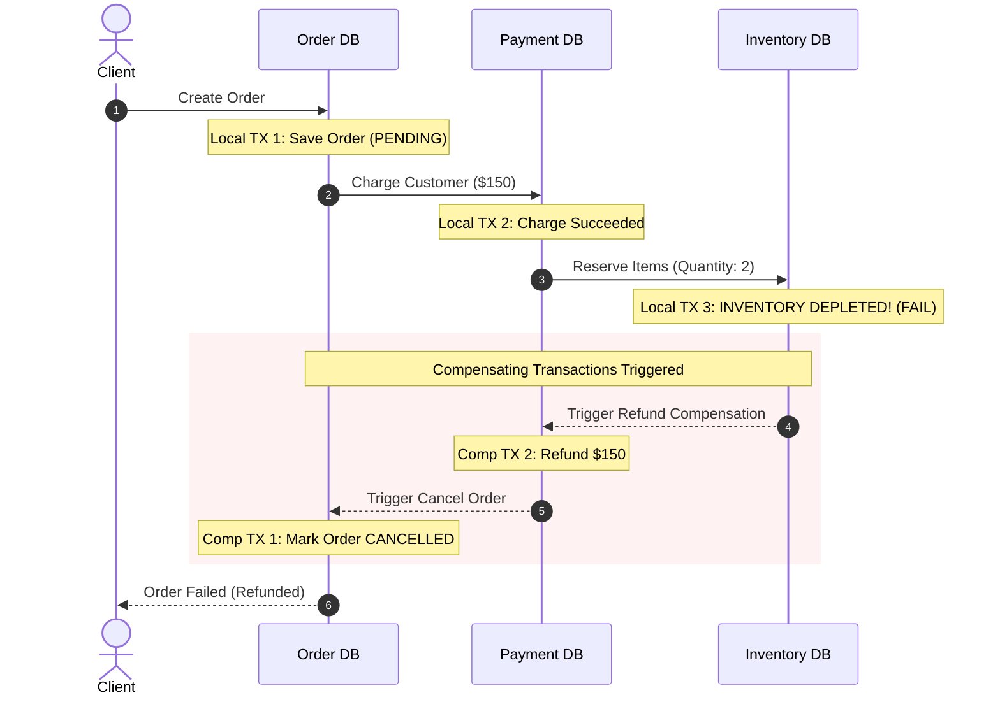

# Spring Boot 4, Distributed Transactions & Architecture Master Interview Guide

> An exhaustive technical reference, deep-dive architectural manual, and senior/staff-level interview guide based on the **E-Commerce Microservice (`java-refresher`)** codebase.

---

## Table of Contents
1. [Codebase Architecture & Spring Boot 4 Configuration Review](#1-codebase-architecture--spring-boot-4-configuration-review)
2. [Deep Dive 1: Spring Transaction Internals & Core Mechanics](#2-deep-dive-1-spring-transaction-internals--core-mechanics)
3. [Deep Dive 2: Multi-Database Coordination & Distributed Transactions (2PC vs. Sagas)](#3-deep-dive-2-multi-database-coordination--distributed-transactions-2pc-vs-sagas)
4. [Deep Dive 3: Managing Large Datasets, High-Throughput Ingestion & Memory Optimization](#4-deep-dive-3-managing-large-datasets-high-throughput-ingestion--memory-optimization)
5. [Deep Dive 4: Concurrency, Locking Strategies & Database Anomalies](#5-deep-dive-4-concurrency-locking-strategies--database-anomalies)
6. [Comprehensive Senior & Staff Interview Q&A Bank (16 Deep Scenarios)](#6-comprehensive-senior--staff-interview-qa-bank)
7. [The Master Study Curriculum & Interview Topic Checklist](#7-the-master-study-curriculum--interview-topic-checklist)

---

## 1. Codebase Architecture & Spring Boot 4 Configuration Review

The [`java-refresher`](file:///Users/luqmansamad/code/feenyx/java-refresher) codebase implements a production-grade **dual-presentation microservice** combining a stateless OAuth2 JWT REST API with a server-rendered Thymeleaf UI, backed by PostgreSQL, Keycloak, and a chunked Spring Batch 6 processing engine.

```
                                  ┌──────────────────────────────┐
                                  │      Client Request (HTTP)   │
                                  └──────────────┬───────────────┘
                                                 │
                                                 ▼
                        ┌───────────────────────────────────────────────────┐
                        │          Spring Security Filter Chain             │
                        └─────────┬───────────────────────────────┬─────────┘
                                  │                               │
         [/api/** - Bearer Token] │                               │ [/** - Session Cookie]
                                  ▼                               ▼
                  ┌───────────────────────────────┐ ┌───────────────────────────────┐
                  │  Order(1): ApiSecurityChain   │ │  Order(2): WebSecurityChain   │
                  │  - Stateless (No Session)     │ │  - Session-based (JSESSIONID) │
                  │  - Keycloak JWT ResourceServer│ │  - Keycloak OIDC SSO Login    │
                  │  - CSRF Disabled              │ │  - CSRF Protection Enabled    │
                  └───────────────┬───────────────┘ └───────────────┬───────────────┘
                                  │                                 │
                                  ▼                                 ▼
                      ┌───────────────────────┐         ┌───────────────────────┐
                      │    @RestController    │         │      @Controller      │
                      │  (JSON Response Body) │         │  (Thymeleaf Template) │
                      └───────────┬───────────┘         └───────────┬───────────┘
                                  │                                 │
                                  └───────────────┬─────────────────┘
                                                  ▼
                                      ┌───────────────────────┐
                                      │     Service Layer     │
                                      │    (@Transactional)   │
                                      └───────────┬───────────┘
                                                  ▼
                                      ┌───────────────────────┐
                                      │  Spring Data JPA Repos│
                                      │  (Hibernate 7 / L1)   │
                                      └───────────┬───────────┘
                                                  ▼
                                      ┌───────────────────────┐
                                      │  PostgreSQL Database  │
                                      └───────────────────────┘
```

### Key Components in this Project

1. **Dual Spring Security Filter Chains ([`SecurityConfig.java`](file:///Users/luqmansamad/code/feenyx/java-refresher/src/main/java/com/practice/java_refresher/security/SecurityConfig.java))**:
   - `@Order(1)` matches `/api/**`: Stateless, CSRF-disabled, OAuth2 JWT bearer token validation using Keycloak claims via [`KeycloakJwtAuthenticationConverter.java`](file:///Users/luqmansamad/code/feenyx/java-refresher/src/main/java/com/practice/java_refresher/security/KeycloakJwtAuthenticationConverter.java).
   - `@Order(2)` matches `/**`: Stateful session management, CSRF tokens, Keycloak OAuth2 / OpenID Connect (OIDC) Single Sign-On (`oauth2Login`) using `ecommerce-client`, mapping realm and resource roles to Spring Security GrantedAuthority instances (`ROLE_USER`, `ROLE_ADMIN`) via [`KeycloakOidcAuthoritiesMapper.java`](file:///Users/luqmansamad/code/feenyx/java-refresher/src/main/java/com/practice/java_refresher/security/KeycloakOidcAuthoritiesMapper.java).

2. **Transactional Order Checkout ([`OrderService.java`](file:///Users/luqmansamad/code/feenyx/java-refresher/src/main/java/com/practice/java_refresher/service/OrderService.java))**:
   - Manages stock verification, atomic inventory decrements, and cascaded order item persistence in a single transaction boundary.

3. **High-Throughput Chunk-Oriented Batch Pipeline ([`BatchJobConfig.java`](file:///Users/luqmansamad/code/feenyx/java-refresher/src/main/java/com/practice/java_refresher/batch/config/BatchJobConfig.java))**:
   - **Step 1 (`importCsvToDbStep`)**: Streams CSV records line-by-line using `FlatFileItemReader` $\rightarrow$ validates via [`ProductCsvProcessor.java`](file:///Users/luqmansamad/code/feenyx/java-refresher/src/main/java/com/practice/java_refresher/batch/processor/ProductCsvProcessor.java) $\rightarrow$ persists in chunks of 50 via `JpaItemWriter`.
   - **Step 2 (`exportDbToJsonStep`)**: Paginates PostgreSQL via `JpaPagingItemReader` $\rightarrow$ transforms via [`ProductJsonProcessor.java`](file:///Users/luqmansamad/code/feenyx/java-refresher/src/main/java/com/practice/java_refresher/batch/processor/ProductJsonProcessor.java) $\rightarrow$ streams JSON directly to disk via [`ProductJsonStreamWriter.java`](file:///Users/luqmansamad/code/feenyx/java-refresher/src/main/java/com/practice/java_refresher/batch/writer/ProductJsonStreamWriter.java).

---

## 2. Deep Dive 1: Spring Transaction Internals & Core Mechanics

### A. How Proxies and AOP Work at Runtime

When Spring boots, `TransactionAttributeSourceAdvisor` detects beans containing `@Transactional` on class or method levels. It wraps the target bean in a **Dynamic Proxy** (CGLIB subclassing by default in Spring Boot, or JDK Dynamic Proxies when interfaces are used).

```
Caller (e.g. Controller / Client)
   │
   ▼
[ Dynamic Proxy (CGLIB Subclass) ]
   │
   ├── 1. Intercepts method invocation via TransactionInterceptor
   ├── 2. Queries PlatformTransactionManager (e.g., JpaTransactionManager)
   ├── 3. Obtains DB Connection from DataSource & binds to ThreadLocal (TransactionSynchronizationManager)
   ├── 4. connection.setAutoCommit(false)
   │
   ▼
[ Actual Target Bean (e.g., OrderService.createOrder) ]
   │
   ├── Executes business logic, repository calls, and SQL queries
   │
   ▼
[ Dynamic Proxy Resumes ]
   │
   ├── 5. Success? connection.commit()
   ├── 6. Exception thrown? Evaluates rollback rules & calls connection.rollback()
   └── 7. Unbinds connection from ThreadLocal & returns to HikariCP pool
```

#### The Self-Invocation Trap

```java
@Service
public class OrderService {

    public void processBatch() {
        // Internal method call:
        this.saveOrder(new Order()); // ❌ TRANSACTION IS COMPLETELY IGNORED!
    }

    @Transactional
    public void saveOrder(Order order) {
        orderRepository.save(order);
    }
}
```

**Why it fails:**
Calls from outside the bean enter through the CGLIB proxy. When `processBatch()` calls `this.saveOrder()`, `this` references the **raw target instance**, bypassing the proxy completely. `TransactionInterceptor` never executes, `connection.setAutoCommit(false)` is never called, and no transaction boundary is established.

**4 Architectural Solutions:**
1. **Separate into Another Bean (Best Practice):** Move `saveOrder` to a dedicated `OrderPersistenceService`.
2. **Self-Injection with `@Lazy`:** Inject `OrderService` into itself:
   ```java
   @Autowired @Lazy private OrderService self;
   public void processBatch() { self.saveOrder(new Order()); }
   ```
3. **`AopContext.currentProxy()`:** Annotate config with `@EnableAspectJAutoProxy(exposeProxy = true)`:
   ```java
   ((OrderService) AopContext.currentProxy()).saveOrder(order);
   ```
4. **AspectJ Bytecode Weaving:** Use compile-time (`ajc`) or load-time weaving (LTW) to weave transaction interception directly into bytecode, removing the need for proxies entirely.

---

### B. Propagation Behaviors & Transaction Trees

Spring supports 7 propagation behaviors defined in `Propagation`:

| Propagation | Existing Transaction Present | No Transaction Present | Common Use-Case |
| :--- | :--- | :--- | :--- |
| **`REQUIRED`** *(Default)* | Joins existing transaction. | Opens a new physical transaction. | Standard business service methods. |
| **`REQUIRES_NEW`** | Suspends existing transaction, opens a new physical connection. | Opens a new physical transaction. | **Audit logging**, payment gateway dispatch, outbox writes that must persist regardless of caller outcome. |
| **`NESTED`** | Creates a JDBC **Savepoint** within current transaction. | Opens a new physical transaction. | Partial rollbacks: attempt secondary payment provider; if it fails, rollback to savepoint without aborting main order. |
| **`MANDATORY`** | Joins existing transaction. | **Throws `IllegalTransactionStateException`**. | Low-level repositories or mutation helpers that must never run outside a transaction. |
| **`SUPPORTS`** | Joins existing transaction. | Executes non-transactionally. | Read methods that can participate in an existing read/write context. |
| **`NOT_SUPPORTED`**| Suspends existing transaction, executes non-transactionally. | Executes non-transactionally. | External network I/O or long-running computations that shouldn't hold DB locks. |
| **`NEVER`** | **Throws `IllegalTransactionStateException`**. | Executes non-transactionally. | Strict safety checks for non-transactional cache updates. |

#### `REQUIRES_NEW` in Action: Auditing & Deadlock Warnings
```java
@Service
public class CheckoutService {
    @Autowired private AuditService auditService;
    @Autowired private OrderRepository orderRepository;

    @Transactional
    public void checkout(OrderRequestDto request) {
        try {
            processPayment(request);
            orderRepository.save(new Order());
        } catch (PaymentException ex) {
            // Must record failure even though checkout aborts:
            auditService.recordAudit("PAYMENT_FAILED", request.getUserId());
            throw ex; // Causes checkout transaction to ROLLBACK
        }
    }
}

@Service
public class AuditService {
    @Transactional(propagation = Propagation.REQUIRES_NEW)
    public void recordAudit(String event, Long userId) {
        // Suspends checkout TX, borrows a 2nd connection from HikariCP,
        // commits audit log, releases 2nd connection, resumes checkout TX.
        auditRepository.save(new AuditLog(event, userId));
    }
}
```
> [!WARNING]
> **HikariCP Pool Exhaustion with `REQUIRES_NEW`:**
> If Thread 1 holds Connection A and requests Connection B for `REQUIRES_NEW`, and all pool connections are occupied by other threads in the same state, a **pool-induced deadlock** occurs. Pool size must be at least:
> $$\text{Pool Size} > \text{Max Threads} \times (\text{Max Nested Connections} - 1)$$

---

### C. Rollback Rules & Checked vs. Unchecked Exceptions

* **Default Behavior:** Spring triggers rollback **only** on **Unchecked Exceptions** (`RuntimeException` and subclasses) and **`Error`** (`OutOfMemoryError`).
* **Checked Exceptions (`Exception`, `IOException`, `SQLException`) DO NOT trigger a rollback by default.** The transaction will commit even if a checked exception escapes!
* **Historical Reason:** Spring followed the EJB standard: checked exceptions represent anticipated business conditions that callers should recover from (e.g., `InsufficientFundsException`), while unchecked exceptions represent unrecoverable technical failures.

```java
// ❌ DANGEROUS: Checked exception escapes, but database changes are COMMITTED!
@Transactional
public void processTransfer() throws InsufficientBalanceException {
    accountRepository.debit(100);
    if (balance < 0) throw new InsufficientBalanceException(); // Will commit debit!
}

// ✅ CORRECT: Explicitly tell Spring to rollback for checked exceptions
@Transactional(rollbackFor = Exception.class)
public void processTransferSafe() throws InsufficientBalanceException { ... }

// Rollback for everything EXCEPT a non-critical notification error:
@Transactional(rollbackFor = Exception.class, noRollbackFor = NonCriticalEmailException.class)
public void placeOrder() { ... }
```

#### Programmatic Rollback Without Throwing Exceptions
```java
if (fraudDetected) {
    TransactionAspectSupport.currentTransactionStatus().setRollbackOnly();
    return OrderResult.rejected("Fraud detected");
}
```

---

### D. Delayed Connection Acquisition: `LazyConnectionDataSourceProxy`

By default, as soon as a thread enters a `@Transactional` method, Spring borrows a physical database connection from HikariCP—even if the method executes 5 seconds of CPU-heavy calculations or REST calls before running its first SQL query!

**The Fix:** Wrap the `DataSource` in `LazyConnectionDataSourceProxy`:
```java
@Bean
@Primary
public DataSource dataSource(DataSource actualHikariDataSource) {
    return new LazyConnectionDataSourceProxy(actualHikariDataSource);
}
```
- A physical connection is **only borrowed from the pool when the first JDBC Statement or PreparedStatement is executed**.
- If a `@Transactional` method exits early due to validation without touching the database, **zero connections are borrowed**, dramatically boosting pool throughput.

---

### E. Open Session in View (OSIV): The Connection Pool Killer

Spring Boot enables `spring.jpa.open-in-view=true` by default.
- It registers an interceptor (`OpenEntityManagerInViewInterceptor`) that binds an `EntityManager` to the HTTP request thread.
- **The Danger:** The database connection is held open across the controller and Thymeleaf/JSON template rendering phase!
- If template rendering is slow or network latency stalls the client response, **database connections remain blocked in the pool**.
- **Production Standard:** Always disable it in `application.properties`:
  ```properties
  spring.jpa.open-in-view=false
  ```
- Solve lazy loading issues in the service/repository layer using **`JOIN FETCH`** or **`@EntityGraph`** ([`OrderRepository.java`](file:///Users/luqmansamad/code/feenyx/java-refresher/src/main/java/com/practice/java_refresher/repository/OrderRepository.java#L16)).

---

## 3. Deep Dive 2: Multi-Database Coordination & Distributed Transactions (2PC vs. Sagas)

### A. The "Writing to Two Databases" Dilemma

A common senior interview scenario is:
> *"Our service needs to insert an Order into `OrderDB` (PostgreSQL) and update user loyalty points in `UserDB` (MySQL / Oracle). How do you handle transaction management across both?"*

```
                     ┌────────────────────────────────┐
                     │     Spring Application         │
                     └───────┬────────────────┬───────┘
                             │                │
                Connection 1 │                │ Connection 2
                             ▼                ▼
                     ┌───────────────┐ ┌───────────────┐
                     │    OrderDB    │ │    UserDB     │
                     │  (PostgreSQL) │ │    (MySQL)    │
                     └───────────────┘ └───────────────┘
```

#### Approach 1: Why `ChainedTransactionManager` (Best-Effort 1PC) is Dangerous & Deprecated
Spring historically offered `ChainedTransactionManager`:
```java
// DEPRECATED IN SPRING 5.3 / BOOT 3
PlatformTransactionManager tm = new ChainedTransactionManager(orderTxManager, userTxManager);
```
**Why it fails:**
It commits sequentially:
1. `orderTxManager.commit()` $\rightarrow$ **Succeeds!**
2. `userTxManager.commit()` $\rightarrow$ **Fails (network crash / timeout)!**
3. `orderTxManager` has already committed. It cannot be rolled back. Result: **Data inconsistency**.

---

#### Approach 2: Two-Phase Commit (2PC) / XA Protocol

Using JTA (Java Transaction API) with an XA-compliant coordinator (e.g., Atomikos, Bitronix, Narayana):

```
       Coordinator (Atomikos / JTA)
           │                    │
  Phase 1: │ PREPARE?           │ PREPARE?
           ▼                    ▼
     [ OrderDB (XA) ]     [ UserDB (XA) ]
     (Locks row; votes YES) (Locks row; votes YES)
           │                    │
  Phase 2: │ COMMIT!            │ COMMIT!
           ▼                    ▼
     [ Both Databases Commit Atomically ]
```

#### Why 2PC / XA Fails in Modern Cloud & Microservices:
1. **Blocking & Latency:** DB locks are held across network hops from Phase 1 prepare until Phase 2 commit completes. Database connection pools rapidly exhaust.
2. **Single Point of Failure (Coordinator):** If the coordinator crashes between Phase 1 and Phase 2, participants remain blocked in "in-doubt" states holding row locks indefinitely.
3. **Incompatible with Modern Infrastructure:** Distributed caches (Redis), message brokers (Kafka/RabbitMQ), NoSQL stores (DynamoDB/Cassandra), and 3rd-party APIs (Stripe, Twilio) **do not support XA protocols**.

---

#### Approach 3: The Production Solution — The Saga Pattern (Eventual Consistency)

Instead of distributed physical transactions, execute a sequence of **local ACID transactions** coordinated via asynchronous messaging. If any step fails, trigger **compensating transactions** to undo previous forward operations.



#### Orchestration vs. Choreography Sagas

| Dimension | Orchestration-Based Saga | Choreography-Based Saga |
| :--- | :--- | :--- |
| **Control** | A centralized **Saga Orchestrator** (State Machine) sends commands to services. | Decentralized: Services react to domain events published to message brokers (Kafka). |
| **Coupling** | Services depend on orchestrator commands; orchestrator knows full workflow. | Services are loosely coupled; only need to know events they produce and consume. |
| **Observability** | **High:** Workflow state, current step, and error states are centralized. | **Low:** Workflow is distributed across event streams; requires distributed tracing (OpenTelemetry). |
| **Failure Handling** | Orchestrator explicitly invokes compensating endpoints in reverse order. | Every participating service must listen for failure events and trigger its own compensation. |
| **Complexity** | Central orchestrator code can grow into a "God object". | High risk of circular event dependencies, event storms, and untraced edge-case failures. |
| **Best For** | Complex flows with 4+ steps (e.g. Order $\rightarrow$ Payment $\rightarrow$ Inventory $\rightarrow$ Shipping). | Simple 2-3 step flows (e.g. User Registered $\rightarrow$ Send Welcome Email). |

---

### B. The Transactional Outbox Pattern & CDC (Debezium)

A critical dual-write failure:
```java
@Transactional
public void createOrder(Order order) {
    orderRepository.save(order);       // 1. DB Commit
    kafkaTemplate.send("orders", order); // 2. Network call to Kafka
}
```
**Anomalies:**
- If Kafka fails or network drops, the DB transaction rolls back, but what if DB commits and Kafka fails right after?
- If Kafka call succeeds but DB commit fails on constraint violation, the message was sent for an order that never existed!

#### Solution: Transactional Outbox Pattern
```
┌────────────────────────────────────────────────────────┐
│               PostgreSQL Database                      │
│                                                        │
│  ┌──────────────────────┐    ┌──────────────────────┐  │
│  │     orders table     │    │     outbox table     │  │
│  │ (id, status, total)  │    │(id, topic, payload)  │  │
│  └──────────────────────┘    └──────────────────────┘  │
│              ▲                          ▲              │
│              │                          │              │
│              └────────────┬─────────────┘              │
│                           │                            │
│           Single Local ACID Transaction                │
└───────────────────────────┼────────────────────────────┘
                            │
               PostgreSQL Write-Ahead Log (WAL)
                            │
                            ▼
               ┌─────────────────────────┐
               │    Debezium CDC         │
               └────────────┬────────────┘
                            │
                            ▼
               ┌─────────────────────────┐
               │       Kafka Topic       │
               └─────────────────────────┘
```

1. Insert business entity into `orders` AND insert an event into an `outbox` table in the **same local ACID transaction**.
2. **Debezium CDC** (Change Data Capture) tails the database transaction log (PostgreSQL WAL) and streams the event into Kafka with zero application-level dual-write risk.
3. Guaranteed **At-Least-Once** delivery. Downstream consumers use an **Idempotency Key** to deduplicate.

---

### C. Designing Semantic Compensating Transactions & Idempotency

#### Compensating Transactions are NOT Physical Rollbacks
- A physical rollback resets database blocks using undo logs.
- A **compensating transaction** is a new **forward-facing business action** that neutralizes the business impact of a previous action (e.g., executing a credit operation to balance an earlier debit).
- **Pivot Transaction:** The point of no return. Once the pivot transaction commits, the Saga must complete forward (cannot be cancelled, only fixed via forward recovery or manual intervention).

#### Idempotency Key Design
Network retries are inevitable. Every consumer must be idempotent:
```sql
CREATE TABLE processed_messages (
    message_id VARCHAR(128) PRIMARY KEY,
    consumer_group VARCHAR(64) NOT NULL,
    processed_at TIMESTAMP DEFAULT CURRENT_TIMESTAMP
);
```
```java
@Transactional
public void handlePaymentRefund(String messageId, RefundCommand command) {
    // 1. Atomic insert check
    int inserted = jdbcTemplate.update(
        "INSERT INTO processed_messages (message_id, consumer_group) VALUES (?, ?) ON CONFLICT DO NOTHING",
        messageId, "payment-service-group"
    );
    if (inserted == 0) {
        log.info("Duplicate message {} ignored", messageId);
        return; // Already processed!
    }

    // 2. Execute refund logic
    paymentGateway.refund(command.getChargeId(), command.getAmount());
}
```

---

## 4. Deep Dive 3: Managing Large Datasets, High-Throughput Ingestion & Memory Optimization

### A. Preventing OutOfMemoryError in Bulk Processing

#### The Hibernate 1st-Level Cache Trap
When querying thousands of rows via `productRepository.findAll()`, Hibernate keeps a reference to **every managed entity** in the `EntityManager` persistence context (1st-level cache) for dirty checking.
- Loading 1,000,000 entities puts 1,000,000 Java objects in heap, causing catastrophic GC pauses and `OutOfMemoryError: Java heap space`.

#### Solutions:
1. **Periodic `flush()` and `clear()`:**
   ```java
   @Transactional
   public void batchUpdate(List<Product> products) {
       for (int i = 0; i < products.size(); i++) {
           entityManager.merge(products.get(i));
           if (i > 0 && i % 50 == 0) {
               entityManager.flush(); // Sends queued SQL to DB
               entityManager.clear(); // Evicts all entities from L1 cache!
           }
       }
   }
   ```

2. **Hibernate `StatelessSession` (Maximum Throughput):**
   ```java
   SessionFactory sessionFactory = entityManagerFactory.unwrap(SessionFactory.class);
   try (StatelessSession session = sessionFactory.openStatelessSession()) {
       Transaction tx = session.beginTransaction();
       // Bypasses 1st-level cache entirely!
       // Zero dirty-checking snapshots, zero entity state tracking.
       session.insert(newProduct);
       tx.commit();
   }
   ```

3. **Spring Batch Chunking ([`BatchJobConfig.java`](file:///Users/luqmansamad/code/feenyx/java-refresher/src/main/java/com/practice/java_refresher/batch/config/BatchJobConfig.java)):**
   - Keeps memory usage strictly bounded to $O(\text{chunk\_size})$.
   - Reads 50 records $\rightarrow$ Processes 50 records $\rightarrow$ Writes 50 records $\rightarrow$ Commits transaction $\rightarrow$ Clears persistence context.

---

### B. High-Performance JDBC Batching Configuration

To enable true multi-row JDBC batching (`INSERT INTO table VALUES (...), (...), (...)`), configure Hibernate and JDBC driver properties:

```properties
# Enable Hibernate Batching
spring.jpa.properties.hibernate.jdbc.batch_size=50
spring.jpa.properties.hibernate.order_inserts=true
spring.jpa.properties.hibernate.order_updates=true
spring.jpa.properties.hibernate.jdbc.batch_versioned_data=true

# CRITICAL for PostgreSQL (re-writes separate INSERTs into a single multi-row statement):
spring.datasource.url=jdbc:postgresql://localhost:5432/ecommerce?reWriteBatchedInserts=true

# CRITICAL for MySQL:
# spring.datasource.url=jdbc:mysql://localhost:3306/ecommerce?rewriteBatchedStatements=true
```

> [!IMPORTANT]
> **GenerationType.IDENTITY Disables Batching:**
> If an entity uses `@GeneratedValue(strategy = GenerationType.IDENTITY)`, Hibernate **must immediately fire an SQL INSERT** for each entity to obtain its database-generated primary key. Batching is completely disabled!
> - **Solution:** Use `@GeneratedValue(strategy = GenerationType.SEQUENCE)` with an allocation size matching the batch size (`allocationSize = 50`), or client-generated UUIDs (`UUIDv7` or `TSID`).

---

### C. Keyset (Seek) Pagination vs. Offset Pagination

| Metric | Offset Pagination (`OFFSET 1000000 LIMIT 50`) | Keyset Pagination (`WHERE id > :lastId LIMIT 50`) |
| :--- | :--- | :--- |
| **SQL** | `SELECT * FROM products ORDER BY id LIMIT 50 OFFSET 1000000;` | `SELECT * FROM products WHERE id > 1000000 ORDER BY id ASC LIMIT 50;` |
| **Complexity** | $O(N)$ — DB must scan 1,000,050 rows and discard the first 1,000,000. | $O(\log N)$ — B-Tree index seek directly locates row 1,000,000. |
| **Execution Time** | Increases linearly with page depth (5000ms+ at deep offsets). | **Constant time ($<2\text{ms}$)** regardless of whether fetching page 1 or page 10,000. |
| **Data Drifts** | New inserts shift offsets, causing duplicate or skipped rows. | **Stable:** Unaffected by concurrent inserts before the cursor. |

---

## 5. Deep Dive 4: Concurrency, Locking Strategies & Database Anomalies

### A. Database Anomalies & Isolation Levels

* **Dirty Read:** Transaction A reads uncommitted writes from Transaction B. If B aborts, A holds invalid data.
* **Non-Repeatable Read:** Transaction A reads row $X$. Transaction B updates/deletes row $X$ and commits. Transaction A re-reads row $X$ and sees mutated values.
* **Phantom Read:** Transaction A queries rows matching a filter (`WHERE price > 100`). Transaction B inserts new rows matching that filter and commits. Transaction A re-runs the query and sees new "phantom" rows.

| Isolation Level | Dirty Read | Non-Repeatable Read | Phantom Read | Engine Mechanism (PostgreSQL / MVCC) |
| :--- | :---: | :---: | :---: | :--- |
| **`READ_UNCOMMITTED`** | Allowed | Allowed | Allowed | Ignored in PostgreSQL (treated as `READ_COMMITTED`). |
| **`READ_COMMITTED`** *(Default)* | **Prevented** | Allowed | Allowed | Each SQL statement sees a fresh snapshot taken at statement start. |
| **`REPEATABLE_READ`** | **Prevented** | **Prevented** | **Prevented\*** | Snapshot taken at transaction start; all queries see the exact same snapshot. (\*In Postgres, prevents phantom reads via MVCC). |
| **`SERIALIZABLE`** | **Prevented** | **Prevented** | **Prevented** | Strict SSI (Serializable Snapshot Isolation); tracks read/write dependencies and aborts on conflict. |

---

### B. Optimistic vs. Pessimistic Locking

#### Optimistic Locking (`@Version`)
No database locks are acquired. A version column tracks revisions:
```java
@Entity
public class Product {
    @Id private Long id;
    private Integer stockQuantity;

    @Version
    private Long version;
}
```
**SQL executed on commit:**
```sql
UPDATE products 
SET stock_quantity = 49, version = version + 1 
WHERE id = 1 AND version = 5;
```
If another transaction updated the row first, `version` is now 6. The `UPDATE` statement matches 0 rows. Hibernate throws `OptimisticLockException`.
- **Pros:** Highest throughput for read-heavy workloads with low write contention.
- **Cons:** High retry overhead under flash-sale or high write contention.

#### Pessimistic Locking (`PESSIMISTIC_WRITE` / `FOR UPDATE`)
Acquires an exclusive row-level lock immediately upon reading:
```java
@Lock(LockModeType.PESSIMISTIC_WRITE)
@Query("SELECT p FROM Product p WHERE p.id = :id")
Optional<Product> findByIdForUpdate(@Param("id") Long id);
```
**SQL executed:**
```sql
SELECT * FROM products WHERE id = 1 FOR UPDATE;
```
- **Pros:** Guarantees strict sequential execution; zero retry code needed.
- **Cons:** Other transactions trying to read (`FOR UPDATE`) or write block until commit. High risk of deadlocks if acquired in inconsistent order.

#### Non-Blocking Queue Ingestion: `SKIP LOCKED`
```sql
SELECT * FROM tasks WHERE status = 'PENDING' ORDER BY id LIMIT 10 FOR UPDATE SKIP LOCKED;
```
Enables multiple worker pods to poll a database table as a queue without blocking each other or returning duplicate rows!

---

## 6. Comprehensive Senior & Staff Interview Q&A Bank

### Q1: You have a Spring Boot service that must write to both PostgreSQL and an external MySQL database in the same method. How do you design this reliably without 2PC/XA?
**Staff Answer:**
1. **Acknowledge the Problem:** A single local transaction manager cannot span physical databases atomically. The deprecated `ChainedTransactionManager` (Best-Effort 1PC) risks partial commits if the second commit fails.
2. **Decompose via the Outbox Pattern:**
   - Designate one database as the **primary authority** (e.g., PostgreSQL for Orders).
   - In PostgreSQL, write the `Order` entity AND an `Outbox` event within a single local `@Transactional` boundary.
   - Commit the PostgreSQL transaction.
3. **Asynchronous Propagation to Secondary Database:**
   - Use Debezium CDC or a dedicated poller to publish the event to Kafka.
   - A consumer in the loyalty service consumes the event, invokes an idempotent write to MySQL (`UserDB`), and acknowledges the offset.
   - If MySQL fails, Kafka retries with exponential backoff or routes to a Dead Letter Queue (DLQ).
4. **Conclusion:** Transition from distributed physical transactions (XA) to **eventual consistency** with idempotency.

---

### Q2: Why does calling `@Transactional` internally from another method in the same class fail? List 3 ways to fix it.
**Answer:**
Spring manages transactions through AOP Dynamic Proxies (CGLIB subclasses). Calls from outside the bean enter through the proxy, which triggers `TransactionInterceptor`. When method A calls `this.methodB()`, `this` references the raw target object, bypassing the proxy.

**3 Fixes:**
1. **Refactor (Best Practice):** Move `methodB` into a separate Spring service bean.
2. **Self-Injection:** Inject the bean into itself with `@Autowired @Lazy private MyService self;` and invoke `self.methodB()`.
3. **`AopContext.currentProxy()`:** Call `((MyService) AopContext.currentProxy()).methodB()` with `@EnableAspectJAutoProxy(exposeProxy = true)`.

---

### Q3: An outer `@Transactional` method calls an inner method with `Propagation.REQUIRED`. The inner method catches an exception and suppresses it. Why does the outer method throw `UnexpectedRollbackException` on commit?
**Answer:**
Both methods share the **same physical transaction**. When the inner method encounters an exception before catching it, Spring's `TransactionAspectSupport` marks the transaction as **`rollbackOnly = true`** on the underlying `TransactionStatus`.

Even though the inner method caught the exception and returned normally, the transaction status remains irrevocably marked for rollback. When the outer method finishes and attempts to commit, Spring checks the rollback status, detects the flag, executes a rollback instead, and throws:
```
org.springframework.transaction.UnexpectedRollbackException: 
Transaction silently rolled back because it has been marked as rollback-only
```
**Fix:** If the inner failure should be recoverable without failing the outer transaction, annotate the inner method with `Propagation.REQUIRES_NEW` or `Propagation.NESTED` (savepoints).

---

### Q4: You need to process 10 million rows from a database table and write them to an S3 file. How do you prevent `OutOfMemoryError` in Spring Boot?
**Answer:**
1. **Never use standard `JpaRepository.findAll()`:** It loads all entities into memory and stores snapshots in the Hibernate 1st-level cache.
2. **Use Spring Batch Chunking or Streaming Cursor:**
   - Configure `JpaPagingItemReader` or `JdbcCursorItemReader` with a `fetchSize` of 1,000.
   - Use `ScrollableResults` or Java `Stream<T>` with `@Transactional(readOnly = true)` to stream directly from the database socket without buffering entire result sets.
3. **Evict L1 Cache:** Clear the `EntityManager` after every chunk (`entityManager.clear()`), or use Hibernate's `StatelessSession` which has no 1st-level cache.
4. **Stream Output:** Write directly to an `OutputStream` piped to AWS S3 multi-part upload, keeping memory bounded to $O(1)$.

---

### Q5: What exact performance optimizations occur under the hood when you annotate a method with `@Transactional(readOnly = true)`?
**Answer:**
1. **Hibernate Skips Dirty-Checking Snapshots:** Normally, loading an entity creates two heap representations: the working instance and an initial snapshot. On commit, Hibernate diffs every property. With `readOnly = true`, Hibernate skips snapshot creation, cutting entity memory allocation by ~50% and eliminating dirty-checking CPU overhead.
2. **`FlushModeType.MANUAL`:** Automatic flushes before query execution are suppressed, preventing unnecessary SQL queries and I/O.
3. **JDBC Connection Optimization:** Calls `connection.setReadOnly(true)` on the JDBC connection, allowing cloud database drivers (e.g., AWS Aurora, PostgreSQL replication clusters) to route the connection directly to read replicas.

---

### Q6: What is the difference between `PESSIMISTIC_WRITE` and Optimistic Locking (`@Version`)? When would you choose one over the other?
**Answer:**
- **Optimistic Locking (`@Version`):**
  - No database locks held during processing. Verifies version at update time (`WHERE id = ? AND version = ?`).
  - Best for: Read-heavy workloads with low-to-medium write contention (e.g., updating user profiles, catalog descriptions).
  - Risk: High retry storms under intense write contention.
- **Pessimistic Locking (`PESSIMISTIC_WRITE`):**
  - Executes `SELECT ... FOR UPDATE`, blocking other write transactions until commit.
  - Best for: High-contention financial operations (e.g., flash sales, stock depletion, bank account balance deduction).
  - Risk: Lower throughput; risk of database deadlocks if entities are locked in non-deterministic orders.

---

### Q7: How does `SELECT FOR UPDATE SKIP LOCKED` work, and how is it used in high-throughput worker architectures?
**Answer:**
Standard `SELECT FOR UPDATE` blocks when encountering locked rows. `SKIP LOCKED` instructs the database engine to check rows matching the `WHERE` clause, and if a row is currently locked by another active transaction, **skip it immediately and lock the next available row**.

**Use-Case: Database as a Message Queue:**
```sql
SELECT * FROM task_queue 
WHERE status = 'READY' 
ORDER BY priority DESC 
LIMIT 10 
FOR UPDATE SKIP LOCKED;
```
Allows 50 microservice instances to poll the same database table concurrently without blocking each other, experiencing lock contention, or processing duplicate tasks.

---

### Q8: What is the Open Session in View (OSIV) anti-pattern, why does Spring Boot enable it by default, and why should you disable it in production?
**Answer:**
- **What it does:** Keeps the Hibernate `EntityManager` open throughout the entire web request lifecycle, including Controller execution and Thymeleaf/JSON serialization.
- **Why it was created:** Convenience for beginners: prevents `LazyInitializationException` when accessing uninitialized collections in views/serializers.
- **Why it is dangerous:** It holds a physical database connection borrowed from HikariCP during view rendering and network I/O. Under load, slow clients or template rendering starve the pool of connections, causing application-wide timeouts.
- **Solution:** Set `spring.jpa.open-in-view=false` and explicitly fetch required relationships using `JOIN FETCH` or `@EntityGraph` within the service transaction.

---

### Q9: What happens when an external REST API call is placed inside a `@Transactional` method? How do you refactor it?
**Answer:**
The database connection borrowed from HikariCP remains open and idle while waiting for the remote HTTP response. If the remote service suffers latency (e.g. 5-second response time), all connection pool threads become exhausted waiting on network sockets, causing an outage across unrelated endpoints.

**Refactoring Pattern:**
Separate the transaction boundary:
```java
public void processPaymentAndOrder(OrderRequestDto request) {
    // 1. Non-transactional external network call:
    PaymentResponse payment = paymentClient.charge(request.getPaymentDetails());

    // 2. Short, isolated transactional write:
    orderPersistenceService.saveOrderAndPayment(request, payment);
}
```

---

### Q10: How does `LazyConnectionDataSourceProxy` prevent connection starvation in Spring Boot?
**Answer:**
By default, entering a `@Transactional` method immediately checks out a connection from HikariCP. If the method performs validations, computations, or external calls before database queries, the connection sits idle.

`LazyConnectionDataSourceProxy` wraps the actual `DataSource`. When a transaction begins, it creates a lazy proxy connection. The actual physical connection is only checked out from HikariCP when the first SQL query or prepared statement is executed. If validation fails before any query runs, **zero connections are borrowed from the pool**.

---

### Q11: Explain the difference between `FlushMode.AUTO` and `FlushMode.COMMIT`. How can `AUTO` cause silent performance degradation?
**Answer:**
- **`FlushMode.AUTO` (Default):** Hibernate flushes the persistence context before executing any JPQL/HQL query if that query touches tables with pending in-memory mutations.
- **`FlushMode.COMMIT`:** Flushes only when the transaction commits or upon explicit `entityManager.flush()`.

**The Silent Trap:**
If you mutate 1,000 entities in memory, and then execute a read query on an unrelated repository in the middle of the loop, Hibernate's query dependency analyzer cannot guarantee independence. It forces a premature flush, firing 1,000 SQL UPDATEs over the network ahead of schedule, thrashing database I/O.

---

### Q12: How do you design an Orchestration Saga with compensating transactions? What happens if a compensation fails?
**Answer:**
1. An **Orchestrator** (State Machine) manages the lifecycle:
   - Step 1: `OrderService.createPending()`
   - Step 2: `PaymentService.debit()`
   - Step 3: `InventoryService.reserve()`
2. If Step 3 fails, the orchestrator executes compensations in reverse order:
   - Comp Step 2: `PaymentService.refund()`
   - Comp Step 1: `OrderService.cancel()`
3. **If a compensation fails:**
   - **Compensations cannot be rolled back.** They must be retried with exponential backoff until success.
   - If retries exhaust, write to a Dead Letter Queue (DLQ) and generate high-priority alerting for human operational intervention.

---

### Q13: Contrast the Transactional Outbox Pattern with Change Data Capture (CDC) vs. a Scheduled Polling Publisher.
**Answer:**
- **Polling Publisher:** A scheduled `@Scheduled` job queries `SELECT * FROM outbox WHERE status = 'PENDING' LIMIT 100 FOR UPDATE SKIP LOCKED`, sends to Kafka, and marks `SENT`.
  - *Pros:* Simple to implement; no external infrastructure.
  - *Cons:* Polling introduces latency; adds read/write query load on database; can become a bottleneck at scale.
- **Debezium CDC (Change Data Capture):** Connects to the database's Write-Ahead Log (WAL in Postgres, binlog in MySQL) and directly streams outbox row inserts into Kafka in real time.
  - *Pros:* Sub-millisecond latency; zero query overhead on DB tables; scales with database transaction log throughput.
  - *Cons:* Requires managing Kafka Connect and Debezium connector infrastructure.

---

### Q14: How does Spring Batch handle transaction rollbacks during chunk processing? What is the role of `skip` and `retry`?
**Answer:**
In Spring Batch, a chunk step executes with a defined commit interval (e.g. 50 items):
1. Reads 50 items $\rightarrow$ Processes 50 items $\rightarrow$ Writes 50 items $\rightarrow$ Commits.
2. If item 48 throws an exception in the writer, the entire transaction of 50 items rolls back.
3. If **Fault Tolerance / Skip** is configured (`faultTolerant().skip(DataException.class).skipLimit(10)`):
   - Spring Batch re-scans the chunk **item-by-item** in individual sub-transactions to isolate the exact failing item.
   - The failing item is logged to step execution metrics (`stepExecution.getFilterCount()`), and the remaining 49 valid items commit successfully.

---

### Q15: How do you size a HikariCP connection pool for a high-concurrency production microservice?
**Answer:**
Using the canonical PostgreSQL / HikariCP sizing formula:
$$\text{Pool Size} = (\text{Core Count} \times 2) + \text{Effective Spindle Count}$$
For a modern multi-core server with SSD storage (effective spindle count = 1):
- A 4-core machine: $(4 \times 2) + 1 = 9$ to $10$ connections.
- An 8-core machine: $(8 \times 2) + 1 = 17$ to $20$ connections.

**Key Insight:** Setting pool size to 200 on an 8-core database does not increase throughput; it destroys performance due to OS CPU context-switching, thread scheduling overhead, and disk queue thrashing. Keep the pool small and optimize query latency!

---

### Q16: How do you architect a dual-layer security model in Spring Boot 4 / Spring Security 6 combining a Stateless OAuth2 Resource Server for REST APIs with OpenID Connect (OIDC) SSO Login for a Web UI using Keycloak?
**Staff Answer:**
1. **Dual `SecurityFilterChain` Strategy with Strict Priority Ordering:**
   - Spring Security processes filter chains sequentially based on `@Order`.
   - `@Order(1)` defines the **API Security Chain** with `.securityMatcher("/api/**")`:
     - Sets `sessionCreationPolicy(SessionCreationPolicy.STATELESS)` — never creates or checks `JSESSIONID`.
     - Disables CSRF (`csrf.disable()`) because bearer tokens stored in memory are inherently immune to browser cross-site request forgery.
     - Configures `.oauth2ResourceServer(oauth2 -> oauth2.jwt(jwt -> jwt.jwtAuthenticationConverter(...)))`.
   - `@Order(2)` defines the **Web Security Chain** matching all other routes (`/**`):
     - Uses standard stateful session management for browser navigation.
     - Keeps CSRF enabled for HTML form submissions.
     - Configures `.oauth2Login(oauth2 -> oauth2.loginPage("/login").userInfoEndpoint(userInfo -> userInfo.userAuthoritiesMapper(...)))`.
2. **Under-the-Hood JWT Validation & JWKS Public Key Resolution:**
   - The Resource Server does **not** call Keycloak on every incoming API request.
   - It fetches the JSON Web Key Set (JWKS) from `jwk-set-uri` (`http://localhost:8777/realms/dev-realm/protocol/openid-connect/certs`) once and caches the RSA public keys locally.
   - Incoming JWTs are verified cryptographically in-memory (signature verification, expiration `exp`, issuer `iss`, and audience `aud`).
3. **Translating Nested Identity Provider Claims to Spring Security Roles:**
   - Keycloak places roles inside nested JSON objects: `realm_access.roles` (realm roles) and `resource_access.<client>.roles` (client roles).
   - Standard Spring Security expects flat `GrantedAuthority` items prefixed with `ROLE_` (e.g., `ROLE_USER`, `ROLE_ADMIN`).
   - Implement custom converters:
     - For REST APIs: `KeycloakJwtAuthenticationConverter` implements `Converter<Jwt, AbstractAuthenticationToken>` to extract claims from `realm_access.roles` and convert them to `SimpleGrantedAuthority`.
     - For Web UI: `KeycloakOidcAuthoritiesMapper` implements `GrantedAuthoritiesMapper` to extract `realm_access` from `OidcUserAuthority.getIdToken().getClaims()` and `getUserInfo().getClaims()`.
4. **Keycloak Client Configuration Pitfalls:**
   - A single client can serve both, or distinct clients can be registered (`ecommerce-client` for confidential browser authorization code flow; `spring-boot-public` for direct ROPC / SPA).
   - In Keycloak, confidential clients require `Client authentication: ON` and valid `Redirect URIs` matching `{baseUrl}/login/oauth2/code/{registrationId}` (`http://localhost:8080/login/oauth2/code/keycloak`).

---

## 7. The Master Study Curriculum & Interview Topic Checklist

Use this structured syllabus to systematically review and master advanced Spring, data architectures, and distributed systems before your interview.

### 📌 Tier 1: Core Transaction Mechanics & Spring Internals
- [ ] **Proxy Generation:** CGLIB class subclassing vs JDK Dynamic Proxies (`java.lang.reflect.Proxy`).
- [ ] **Self-Invocation:** Why calling `@Transactional` internally fails and how to fix it (separate bean, `@Lazy` self-injection, `AopContext.currentProxy()`).
- [ ] **Propagation Behaviors:** Precise semantics of `REQUIRED`, `REQUIRES_NEW`, `NESTED`, `MANDATORY`, `SUPPORTS`, `NOT_SUPPORTED`, `NEVER`.
- [ ] **JDBC Savepoints:** How `Propagation.NESTED` maps to `connection.setSavepoint()` and partial rollback.
- [ ] **Rollback Mechanics:** Why checked exceptions don't roll back by default; using `rollbackFor = Exception.class` and `noRollbackFor`.
- [ ] **ThreadLocal Management:** How `TransactionSynchronizationManager` binds connections to execution threads.
- [ ] **Delayed Checkout:** How `LazyConnectionDataSourceProxy` defers connection acquisition until the first statement execution.

### 📌 Tier 2: Database Performance, Concurrency & Locking
- [ ] **Dirty Checking Internals:** Why `@Transactional(readOnly = true)` suppresses entity snapshots in Hibernate.
- [ ] **Hibernate 1st-Level Cache:** Why iterating large datasets causes `OutOfMemoryError` and how `entityManager.clear()` fixes it.
- [ ] **`StatelessSession`:** Bypassing the persistence context, dirty checking, and event listeners for ultra-fast bulk operations.
- [ ] **JDBC Batching:** Configuring `hibernate.jdbc.batch_size`, `order_inserts`, `order_updates`, and JDBC driver flags (`reWriteBatchedInserts=true`).
- [ ] **Primary Key Pitfall:** Why `GenerationType.IDENTITY` disables JDBC batching and why `SEQUENCE` or `UUID` is required.
- [ ] **Isolation Levels:** Dirty Reads, Non-Repeatable Reads, Phantom Reads, and how MVCC prevents anomalies in PostgreSQL.
- [ ] **Optimistic Locking:** `@Version` mechanics, `OptimisticLockException`, and retry handling with Spring `@Retryable`.
- [ ] **Pessimistic Locking:** `PESSIMISTIC_WRITE` (`FOR UPDATE`), `PESSIMISTIC_READ` (`FOR SHARE`), `NOWAIT`, and `SKIP LOCKED`.
- [ ] **Pagination Strategies:** Mathematical proof of why Keyset (Seek) Pagination ($O(\log N)$) outperforms Offset Pagination ($O(N)$).
- [ ] **OSIV Anti-Pattern:** Why `spring.jpa.open-in-view=false` is mandatory in production systems.

### 📌 Tier 3: Distributed Systems, Sagas & Eventual Consistency
- [ ] **The Dual-Write Problem:** Why writing to a database and publishing to Kafka cannot be coordinated with local transactions.
- [ ] **Two-Phase Commit (2PC):** Prepare phase, commit phase, coordinator single-point-of-failure, and latency bottlenecks.
- [ ] **Saga Pattern:** Orchestration (Central State Machine) vs Choreography (Event-Driven messaging).
- [ ] **Semantic Compensating Transactions:** Backward recovery vs Forward recovery, and handling compensation failures.
- [ ] **Transactional Outbox Pattern:** Outbox table schema, Debezium Change Data Capture (CDC), and Write-Ahead Log (WAL) reading.
- [ ] **Idempotent Consumers:** Deduplication table schemas, idempotency keys, and handling at-least-once message delivery.
- [ ] **Distributed Sagas Tooling:** Temporal.io, Camunda, AWS Step Functions, Spring StateMachine.

### 📌 Tier 4: Spring Batch & High-Throughput Pipelines
- [ ] **Architecture:** `Job`, `Step`, `JobRepository`, and `JobOperator` (Spring Batch 6 replacement for deprecated `JobLauncher` and `JobExplorer`).
- [ ] **Chunk-Oriented Processing:** `ItemReader` $\rightarrow$ `ItemProcessor` $\rightarrow$ `ItemWriter` transaction boundary.
- [ ] **Restartability:** How `ExecutionContext` records chunk commit counts to resume mid-job after a server crash.
- [ ] **Fault Tolerance:** `skip()`, `skipLimit()`, `retry()`, and item-by-item rollback recovery.
- [ ] **Scaling Batch:** Multi-threaded steps, partitioning (`Partitioner`), and remote chunking via Kafka.

### 📌 Tier 5: Cloud Identity, OAuth2 Resource Server & OIDC SSO
- [ ] **Dual Filter Chain Architecture:** `@Order(1)` stateless REST API chain with `securityMatcher("/api/**")` vs `@Order(2)` stateful MVC session chain.
- [ ] **Cryptographic In-Memory Token Validation:** Public key caching via Keycloak JWKS (`jwk-set-uri`), RS256 signature verification, and clock skew tolerance.
- [ ] **Translating Provider Claims:** Extracting nested `realm_access.roles` and `resource_access.<client>.roles` to Spring Security `GrantedAuthority` (`ROLE_USER`, `ROLE_ADMIN`).
- [ ] **OpenID Connect Authorization Code Flow:** PKCE parameters (`code_challenge`), redirect URIs, and user info mapping via `GrantedAuthoritiesMapper`.
- [ ] **CSRF Mechanics:** Why stateless JWT APIs disable CSRF while browser session cookies require synchronizer tokens.

### 📌 Tier 6: Real-World Scenario Interview Questions
- [ ] Can you design a flash-sale ticketing system capable of handling 50,000 requests/second without stock overselling?
- [ ] How do you handle database migration on a table with 500 million rows without taking downtime (Expand/Contract pattern)?
- [ ] What happens to database transactions during a network partition (CAP theorem: CP vs AP)?
- [ ] How do you size HikariCP connection pools, thread pools, and database connection limits?
- [ ] How do you prevent deadlocks when multiple transactions update multiple rows concurrently? (Always sort entity IDs before acquiring locks!).
